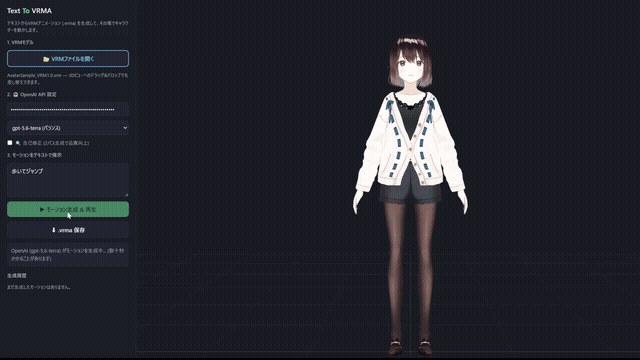

# Text-To-VRMA — VRM-Specialized Text-To-Motion Tool

[](https://github.com/sponsors/Kirakun0328)



A web application where you enter text, and AI generates motion, creating a **VRMA (VRM Animation / `.vrma`)** file directly within your browser to animate your VRM character on the spot. The generated `.vrma` files can be saved and used directly in any VRMA-compatible application.

Examples: "walk in place", "jump with joy", "wave hand", "look down sadly"

## ✨ Key Features
- 📝 **Text-to-Motion Generation** (Japanese supported) — Powered by two engines: LLM Keyframe / NVIDIA ARDY
- 🧠 **Jev (TypeSafe AI) Support** — Analyzes emotion, gaze, and movement tempo from input text, automatically supplementing facial expressions and movement styles (v1.1.9+)
- 🚀 **Latest Model Support** — OpenAI GPT-6 generation (`gpt-6-astra` / `gpt-6-sol` / `gpt-6-luna`), and Claude Fable 5.1 / Opus 5.5 / Sonnet 5.5 / Haiku 5.5
- 💳 **Codex Subscription Support** — In addition to the desktop version, you can utilize your quota directly from the local web version
- 🎬 Export generated motion as **GIF / Video (1080p)** — Share directly on social media
- 🎨 **Custom Background Colors** — Set solid background colors for chroma key compositing (e.g., green screen)
- ⏱ **Specify Motion Length in Seconds** (leave blank for auto-detection, with an "auto-correction" option)
- ▶ **Playback Seekbar** — Displays current seconds, scrub to any point, and pause
- 📍 **Waypoint Mode** — Click on the 3D view floor to specify movement paths (ARDY)
- 🎭 **Physical Expression of Emotion** — Reflects not just facial expressions, but also posture, arms, center of gravity, and movement dynamics
- 🔍 **AI Motion Review** — AI evaluates necessity after generation and applies corrections only when needed
- 🎯 **Instruction-Following Check** — Measures movement, jumping, crouching, and hand-raising on the avatar
- 🎲 **Generate and Compare 3 Candidates** — Generate with different seeds to compare and choose the best one
- ✨ **Full-Body Smoothness Correction** — Softens abrupt angle changes while preserving grounding areas
- 🔁 **Loop Playback** — Connects the beginning and end for seamless playback
- 😊 **Automatic Facial Expression Generation** + 4-Language UI (Japanese / English / Chinese / Korean)
- 🔌 **OpenAI-Compatible Provider Support** — OpenRouter, DeepSeek, Ollama, and more can also be used
- 🟣 **Claude API Support** — Generate motions using Anthropic's Claude (claude-opus-5-5, etc.)
- 🧭 **Connection Guidance** — If connection fails (e.g., when the ARDY engine is not running), it displays the cause along with buttons like "Start Engine"


You can choose from two generation engines:

| Engine | Features | Requirements |
| --- | --- | --- |
| **LLM Keyframe** (OpenAI API / Claude API / Codex / Compatible APIs) | Excels at precise pose, finger, and facial expression specification. Works on any PC with no setup required. Supports OpenAI-compatible APIs (OpenRouter, DeepSeek, Ollama, etc.) as well as Anthropic's Claude API. | API Key or Codex Plan |
| **ARDY Local Engine** (v1.1+) | Locally runs NVIDIA's motion generation AI [ARDY](https://github.com/nv-tlabs/ardy). Full-body movements like walking, dancing, and jumping are of **motion capture quality**. Unlimited generation, works offline. | Additional setup (see below) |

In ARDY mode, ARDY generates the physical motion. When combined with Codex, it designs the body and facial expressions for the initial movement segment before starting generation and playback, designing subsequent segments concurrently. It preserves the timestamps and contents of finalized segments and appends them to the end. "ARDY Only" generates directly from the input text. Jev's analysis is used concurrently as an auxiliary tool. Standard new generations are independent, and during generation, re-inputs or explicit additive corrections seamlessly connect from the current physical history. For operations and constraints, please refer to [ARDY Continuous Generation](docs/ardy-realtime.md).

| Motion-Planning AI | Requirements | Notes |
| --- | --- | --- |
| **ARDY Only** (Default) | None | Generated using ARDY's built-in translation. |
| **Codex Subscription** | ChatGPT / Codex Plan | Displays usage rate, remaining quota, and reset time in the settings panel. |
| **OpenAI API** | API Key | GPT-6 Astra / GPT-6.1 Sol (Default) / GPT-6 Luna |
| **Claude API** | API Key | Fable 5.1 / Opus 5.5 (Default) / Sonnet 5.5 / Haiku 5.5 |

- If authentication or planning fails during continuous generation using Codex, the reason will be displayed. It will not automatically switch to ARDY Only or paid APIs. Direct generation can be selected via "ARDY Only".
- For post-generation review and quality settings, please refer to [How Motion Quality Works](#how-motion-quality-works).

Simultaneously with the motion, **facial expressions** (smiles, sadness, surprise, blinking, etc.) are also generated. 
Blink intervals have natural variations and are suppressed during surprised expressions.
When saving the `.vrma` file, you can choose whether to "Include / Exclude facial expressions (bone motion only)".

The UI is available in **Japanese / English / Chinese / Korean** — switch instantly via the selector in the top-right corner.
(Automatically determined from browser language settings on first launch).
*The UI is available in Japanese, English, Chinese and Korean — switch instantly from the selector at the top.*


## Setup & Startup

> 🎁 **For Windows users who want to use it without building:**
> [Download the latest zip from Releases](https://github.com/Kirakun0328/text-to-vrma/releases/latest)
> — Just extract it and double-click the exe (no installation required; a complete ARDY engine setup is also bundled).
> All of the setups below are unnecessary.

If running from source, there are two ways. If you are unsure, **A. Browser Version** is the fastest.

| | Startup Command | Best For |
| --- | --- | --- |
| **A. Browser Version** | `npm run dev` | Those who want to try it first (All OSs, shortest 3 commands) |
| **B. Desktop Version (Electron)** | `npm run build` → `npm run app:dev` | Those who want to use Codex subscription authentication, or in-app setup and auto-startup of the ARDY engine |

**Prerequisites:**

| What to do | Requirements |
| --- | --- |
| Common | Node.js 20+, git |
| Motion Generation (LLM Keyframe) | OpenAI API Key (obtained from [platform.openai.com](https://platform.openai.com/)) or Claude API Key (obtained from [console.anthropic.com](https://console.anthropic.com/)). Alternatively, Codex and a ChatGPT/Codex plan can be used for the local web and desktop versions. |
| ARDY Local Engine (Optional) | See the [ARDY Local Engine section](#ardy-local-engine-optional) below (Python 3.10+ / git, approx. 20GB download). **This can run without an API key.** |

The VRM model includes the VRM 1.0 and VRM 0.0 versions of the [VRoid Official Sample Model (AvatarSample)](https://hub.vroid.com/characters/2843975675147313744/models/5644550979324015604), and the VRM 1.0 version is loaded on startup. You can also swap it out for your own `.vrm` files, as **both 0.x and 1.0 formats are supported** (three-vrm automatically detects them and normalizes the orientation).


### A. Browser Version

```sh
git clone https://github.com/Kirakun0328/text-to-vrma.git
cd text-to-vrma
npm install
npm run dev
# → Open http://localhost:5173 in your browser
```

### B. Desktop Version (Electron)

```sh
git clone https://github.com/Kirakun0328/text-to-vrma.git
cd text-to-vrma
npm install
npm run build
npm run app:dev
```


- The Electron version loads the Vite build output (`dist/index.html`). For the initial run and after source code changes, **make sure to run `npm run build`** before starting with `npm run app:dev` 
  (if you are just restarting with an already built version, `npm run app:dev` alone is fine).
- Codex subscription authentication is available in the desktop version and the local web version (`npm run dev` / `npm run preview`).

  To use it, please make sure to install, authenticate, and configure the PATH for the Codex CLI beforehand 
  (the Codex CLI is not bundled with the app).
  If it is missing or outdated, the app will display instructions for installation and updates 
  (verified with v0.153.3).
  The local web version connects to `codex app-server` via the same-origin Node server.
  It cannot be used when serving static files only. The model list is fetched from the logged-in account, and if GPT-6 Astra is not listed, it cannot be selected on the subscription side yet.
  Running `npm install` on the source version also installs the verified Codex CLI 0.153.3.
  It prioritizes the CLI within the project, and only falls back to the PATH CLI if it does not exist.
  Older CLIs may not list available Astra models (verified in 0.144.1 and 0.153.3).

> [!NOTE]
> The current `npm run app:build` (exe generation) is exclusively for the Windows Portable version. It does not generate `.app` or `.dmg` files for macOS.

## Usage

1. Upon startup, the sample model (AvatarSample VRM 1.0 version) is loaded.

   You can swap it out for your own VRM by clicking "Open VRM File" or dragging and dropping onto the 3D view.
2. Select the generation engine
   - **OpenAI API Key**: Enter your key and select a model. The key is stored only in the browser's 
     localStorage and is never sent to anyone other than OpenAI.
     By specifying a base URL and model name via "🔌 Use OpenAI-compatible provider", 
     you can also use compatible APIs such as OpenRouter, DeepSeek, or Ollama.
     You can also select **GPT-6 Astra** (`gpt-6-astra`) from the model list.
     It can be used for generation, self-correction, and ARDY's motion planning; the default model is `gpt-6.1-sol`.
     According to the [Official OpenAI Model Information](https://developers.openai.com/api/docs/models/gpt-6-astra), 
     it is rolling out gradually, so your API project must have access rights.
     For local HTTP APIs, you can specify `gpt-6-astra` for the request `model` 
     or set the environment variable `OPENAI_MODEL=gpt-6-astra`.
   - **Claude API**: Enter your Anthropic Claude API key (`sk-ant-...`) and select a model 
     (`claude-fable-5-1` / `claude-opus-5-5` / `claude-sonnet-5-5` / `claude-haiku-5-5`).
     The key is stored only in the browser's localStorage and is never sent to anyone other than Anthropic.
     Claude API support is contributed by [@AUDOSt0ck1ng](https://github.com/AUDOSt0ck1ng) 
     ([#9](https://github.com/Kirakun0328/text-to-vrma/pull/9)), and **while contributors have verified it works in both browser and desktop versions, it has not been verified in the author's environment**.
     Bug reports and operation feedback are welcome.
   - **Codex Subscription (Desktop & Local Web Version)**: Click "Login with ChatGPT" 
     to authenticate in your default browser. If you are already logged in via the Codex CLI, that authentication is reused.
   - **ARDY Local Engine**: Motion generation AI running locally (see section below)
3. Direct the movement with text and click "▶ Generate & Play Motion" (Ctrl+Enter is also available)
   - You can specify the motion length using "⏱ Length (sec)" (leave blank for auto-detection).
   - Turning on "Auto-correct length" automatically adjusts it to a natural length appropriate for the number of actions.
   - Under "Loop Playback", you can choose Automatic / Always Loop / Play Once.
   - "🔍 Self-Correction" (LLM mode) runs an additional pass after generation to improve quality.
   - **Acting Design + Image Review**: Available with Codex (subscription quota) or the official GPT-6 Astra API.
     Plans acting cues, support leg, center of gravity, gaze, and limb arrival positions, generating using the actual dimensions of the loaded VRM.
     Sends front and side stop-motion images and measured positions back to the model, correcting once (total of 3 generations).
     API mode is pay-per-use, Codex mode requires a ChatGPT login and does not automatically switch to an API key.
     Supports 1 to 15 seconds. Executed in place of "Regular Self-Correction".
     In the post-completion comparison panel, you can play back before/after correction and review the acting design, measured values, and sent images.
     Candidates with significantly worsened metrics are not auto-selected, but are kept for comparison. Measured values do not guarantee physical quality.
     "Speed Priority" limits reasoning volume and key count, while "Quality Priority" thinks more thoroughly.
     Plays the first draft first before correction completes. Displays the time until the first draft and total time in the comparison panel.
4. The generated movement is played back in the 3D view
   - You can check the current seconds, scrub to any point, and pause using the **playback bar** at the bottom.
   - Adjust the preview using **Reset Camera / Fullscreen** at the top right and **Switch Background** at the bottom.
5. Export from "4. Export & Share"
   - **⬇ Save .vrma** — A file usable in VRMA-compatible apps (VRoid Hub, cluster, etc.)
   - **🎞 Export GIF / 🎬 Export Video** — Export in 1080p and share directly to social media
   - You can also play, save, and export GIF/video from each item in the generation history.


## How Motion Quality Works

Rather than outputting generated motions as-is, quality is enhanced across multiple stages.
Please note that all of these are **auxiliary measures based on geometric measurements and do not guarantee quality**.

### Generation Quality

You can choose from "Standard", "Speed Priority", and "Quality Priority" (Standard is the default).
This changes the amount of inference and the number of review iterations during planning. Speed priority limits inference, while quality priority thinks through things thoroughly and performs re-evaluations up to 2 times.

### End-Pose Preservation

In continuous generation, body parts that should not move in each segment are fixed. Arms that were resting down are kept hanging in the direction of gravity even if the torso tilts, and in segments ending with "lowering arms", only the arms that are still raised are moved. Segments starting in mid-air animate the up-and-down movement of the legs and hips to land.
For details, please refer to [End-Pose Preservation](docs/end-pose-holding.md).

### AI Motion Review

After generation, the AI **first determines whether correction is necessary**. If not, the original movement is adopted as-is, and the reason is displayed in the preview's "Compare Before/After Correction".

- **Standard & Quality Priority** — Applies corrections directly to the joints of the original motion and re-evaluates them using a separate judgment.

- **Speed Priority** — Reviews instructions sent to ARDY and regenerates.

- **Use Images Too** — The app automatically captures front and side photos of the generated motion and sends them to the selected AI.

  (Users do not need to prepare reference images themselves.)

Auto-correction is OFF by default. You can execute it manually after generation via "Correct this motion".
If physical metrics worsen or requested actions disappear, it will not be auto-adopted.
ARDY's end-pose is preserved, and forced upright interpolation that causes foot sliding is avoided.

| | |
| --- | --- |
| Supported Length | 1 to 15 seconds (Feature available in Web and Desktop versions) |
| Information Passed to AI | Foot sliding, joint angular velocity, limb velocity, and acceleration |
| How Foot Sliding is Measured | Approximates ground contact from foot height and vertical velocity. **This is not a physical simulation or full-body collision detection.** |

### Instruction-Following Check

Detects four types of movements—locomotion, two-footed jumping, lowering hips, and raising hands near the face—by measuring joint positions on the avatar at up to 20Hz.

This is a **geometric proxy metric**. It does not guarantee strict step counts, movement directions, action order, facial expressions, naturalness, collisions, or physical stability.

### Generate and Compare 3 Candidates

If you want to compare, you can generate 3 candidates using different seeds and compare them side-by-side (normally 1 candidate).
When comparable checks are available, detection count is prioritized, and foot sliding and sinking are also checked.
While this does not trigger additional AI planning calls, ARDY's generation time increases.


### Full-Body Smoothness Correction

Softens sudden angle changes (ON by default, found in "Detailed Motion Settings").
In addition to the arms and upper body, this also targets the legs, ankles, hips, and fingers.

Ground contact is estimated from ankle height, and **correction is reduced in lower foot segments to maintain the movement path**.
This is an estimation based on ankle height, not an IK fix measuring actual avatar sole contact.
It does not guarantee ground contact judgment on stairs, steps, or special postures, nor does it completely prevent foot sliding.

### Loop Playback

If there is a finite number of repetitions or a concluding motion, it does not loop automatically, but instead holds the final pose.
When explicitly looping, the beginning and end are overlapped and connected.
For loops involving locomotion, position and orientation are accumulated, suppressing the issue of returning to the origin every cycle.

> This transition handling is **for playback within the viewer only**. The same processing is not baked into exported `.vrma` files.

## ARDY Local Engine (Optional)

A mode that runs NVIDIA Research's text-to-motion model 
[ARDY](https://research.nvidia.com/labs/sil/projects/ardy/) (SIGGRAPH 2026) 
locally to generate motion-capture-quality full-body motion.

**What it can do:**

- Generates full-body movements like walking, running, dancing, jumping, and combat using AI trained on actual human motion capture data (center-of-gravity shifts, momentum, and foot contact look authentic).
- **Japanese prompts supported** — Automatically translates into English via local translation (FuguMT). 
  If an OpenAI API key is saved, GPT handles both English translation and splitting continuous actions, improving accuracy.
- **📍 Waypoint Mode** — Click on the 3D view floor to place waypoints, generating motion for the character to pass through in that order (right-click to undo one).
- **Multi-step actions** like "walk, run, jump, and trip" can also be split and verified by GPT, connecting and generating up to 12 actions (when an API key is saved).
- Motion length can be specified in seconds (0.1s+) or automatically determined from content. Expressions and loop availability are also automatic.
- Unlimited generations, completely local (runs offline after setup).


**System Requirements & Performance:**

| | Minimum | Recommended |
| --- | --- | --- |
| OS | Windows 10/11 64-bit, macOS, Linux | Same as left |
| RAM | 16GB | 32GB+ |
| Disk | 35GB | Same as left |
| GPU | VRAM 4GB+ (or CPU, taking a few dozen seconds per generation) | NVIDIA GPU 6GB+ (a few seconds per generation) |

> 💡 **While the official ARDY demo requires 20–24GB of VRAM, this app reduces the VRAM usage of the motion model itself to approximately 1.2GB in actual measurements** (because the 8B LLM text-understanding component, which accounts for most of the VRAM, runs on the CPU side). VRAM hardly increases during generation either (actual measurement: +approx. 12MiB).
> Since the motion model itself and the number of diffusion steps remain identical to the official version, **generation quality is not compromised at all**.
> * Figures are actual measurements via `nvidia-smi` (VRAM difference between process stop/start).
> Since model usage is around 1.2GB and does not increase during generation, adding desktop display overhead means it is **expected to run sufficiently on a GPU with 4GB of VRAM** (verified on 12GB; 4–6GB is untested, so 6GB+ is recommended).
> Even without a GPU, it runs on the CPU (though generation will be several times slower).

**3-Layer Architecture Supporting Quality** — Division of roles: "GPT is the brain, ARDY is the body":

| Layer | Role |
| --- | --- |
| GPT (Optional / When API key is saved) | Japanese intent understanding, splitting continuous actions, rephrasing into English expressions that ARDY handles well |
| Llama-3-8B (Local / CPU) | Converts English text into ARDY-specific vectors (LLM2Vec) |
| ARDY (Local / GPU) | Generates movement using AI trained on actual motion capture data |

Everything can be completed via local translation (FuguMT) even without an API key, but having a key improves the reproduction accuracy of complex instructions like "run, then jump, and finally bow".

**Setup** (Requires Python 3.10+ and git; downloads approx. 20GB):

Windows:

```powershell
powershell -ExecutionPolicy Bypass -File tools\ardy-engine\install.ps1
```

macOS:

```bash
bash tools/ardy-engine/install_mac.sh
```

Linux:

```bash
bash tools/ardy-engine/install_linux.sh
```

The Linux version supports `apt`, `dnf`, `yum`, `pacman`, and `zypper`, and automatically installs Python 3.10+, git, and C++ build tools (`gcc`/`g++`, `cmake`) as needed (using `sudo` for package installations).
If an NVIDIA GPU is present, it automatically selects the CUDA version of PyTorch (determined via `nvidia-smi`).
When using it from the browser version, please start the engine manually using the `server.py` startup command displayed upon completion of the setup.

If Homebrew is not installed on macOS, it will be automatically installed during setup.
macOS support is contributed by [@emadurandal](https://github.com/emadurandal) ([#2](https://github.com/Kirakun0328/text-to-vrma/pull/2)), and Linux support is contributed by [@mouseos](https://github.com/mouseos) ([#7](https://github.com/Kirakun0328/text-to-vrma/pull/7)).
**The developer (author) has only verified functionality on Windows; macOS and Linux have not been verified in the author's environment**
(macOS and Linux have been verified on real hardware by their respective contributors).
Bug reports, operational feedback, and pull requests for fixes on these environments are welcome.

After completion, start the engine and select the "ARDY Local Engine" mode in the app.
For details, manual startup, and APIs, please refer to [tools/ardy-engine/README.md](tools/ardy-engine/README.md).

This feature uses Meta Llama 3 as its text encoder. **Built with Meta Llama 3**

## Meaning and Emotion Analysis via Jev (TypeSafe AI) (Optional)

[Jev](https://typesafe.ai/) is TypeSafe AI's "System One Model". Unlike LLMs that generate text, it is a model that rapidly classifies input sentences into typed choices and scores.
In Text-To-VRMA, **Jev does not create the motion itself**. Its role is strictly to analyze:

- The emotion of the input text (`emotion`) and its intensity (`emotion_intensity`)

- Independent scores for each emotion (`affect`) and item-by-item confidence (`confidences`)

- Energy volume (`movement_energy`), scale of movement, tempo, interpersonal attitude, and specified gaze

and pass those results **as auxiliary information** to the generation prompt (common across ARDY, OpenAI, Claude, and Codex). It prioritizes the original text and does not fix the type of action. The legacy classification `reaction` is for analysis API compatibility and is not passed to physical generation. Independent emotion scores are also used for preliminary facial expressions; if ARDY's face is undesigned, it is interpolated into VRMA as a brief opening expression.
Existing expression tracks and mid-stream emotional shifts are preserved.

**If you have a Jev API key, it will be used automatically.** If unconfigured, in case of an error, or upon timeout, generation continues without Jev. Even if overall confidence is low, the entire analysis is not discarded; it is handled according to the confidence of each item.
In continuous generation combined with Codex, segment design and Jev analysis run concurrently, and ARDY starts once the initial body and facial expression segments are finalized.
Subsequent plans are appended to the end, and later-arriving Jev analyses are passed to the generation conditions of unplayed segments. They do not overwrite already played movements or expressions designed by Codex.

### How to Enable It

- **App / Browser Version**: Enter your Jev API key in the Settings field (located to the left of the language selector, in the same row as other API keys) and select a model (`jev-latest` / `jev-preview` / `jev-1.13.0`). Changes are saved automatically.
- **Local HTTP API (`npm run api`)**: Set `JEV_API_KEY` in your `.env` file. 
  You can explicitly disable the server globally by setting `JEV_ENABLED=false` (see `.env.example`).

### Japanese is Translated into English Before Analysis

Jev primarily targets English, and TypeSafe AI documentation notes that accuracy drops for other languages. Therefore, Japanese inputs are first translated into English using the translation model (FuguMT) built into the ARDY engine before being sent to Jev. If the ARDY engine is not running or the translation does not finish within 2 seconds, the original text is sent as-is, just like before. You can turn this off via "Translate to English before sending to Jev" in the settings 
(or via environment variable `JEV_TRANSLATE=0` for the local HTTP API). Action-planning AIs (such as Astra or Claude) receive the Japanese text as-is.

### Handling of API Keys

Following the same policy as OpenAI and Claude keys. In the app, keys are saved in `localStorage` and sent to Jev (`https://api.typesafe.ai`) via Electron IPC or a same-origin local connection server. There is no hardcoding in the source code, and they are not output to logs (analysis result logs retain only emotions, reactions, and confidence levels, omitting API keys and full input text).


### Usage from the Local HTTP API

`use_jev` in `POST /v1/motions` is an optional boolean. When omitted, it is used automatically if a key exists on the server, and if `false`, analysis is skipped for that request only.

```bash
curl -X POST [http://127.0.0.1:8787/v1/motions](http://127.0.0.1:8787/v1/motions) \
  -H "Content-Type: application/json" \
  -d '{"prompt":"Yay! It is finally finished!!","engine":"ardy","use_jev":true}'
```

If you only want the analysis results (without generating motion), you can use the dedicated endpoint.

```bash
curl -X POST [http://127.0.0.1:8787/v1/motion-context](http://127.0.0.1:8787/v1/motion-context) \
  -H "Content-Type: application/json" \
  -d '{"text":"Eh!? Really!?"}'
# => {"emotion":"surprise","emotion_intensity":0.8,"reaction":"startled", ...}
```


`use_jev` will only function when `JEV_API_KEY` is configured on the server side and has not been explicitly disabled; requests cannot pass an API key or override the administrator's configuration. Existing Host/Origin/token verifications apply equally to these two endpoints.

### Regarding Network Communication

When Jev is enabled, the input text (truncated to a maximum of 2,000 characters) is sent to the TypeSafe AI API (`https://api.typesafe.ai`). New generations do not send previous acting states.
Explicit additive corrections also pass limited states of the current movement, posture, expression, and playback position.

Routing, late arrival, and confirmation of application to the physical body are recorded in `jevContext`, `jev`, and `realtime.jev` within the generation spec.
For routing and constraints, please refer to [Integration of Jev into the Generation Pipeline](docs/jev-generation-integration.md).

## Architecture


```text
[LLMキーフレームモード]
テキスト ── OpenAI API / Codex CLI ──▶ モーション spec (ボーン別オイラー角キーフレーム JSON)

[ARDYモード]
テキスト ── 選択したAI (演技計画・動作分割) ──▶ ARDYエンジンサーバー (localhost:2337)
              │  Codex / OpenAI / Claude        │ 拡散モデルで20fpsモーション生成
              └ AIなしならARDY内蔵翻訳          │ → 足滑り補正 → VRMリターゲット
                                                ▼
                                    モーション spec ──▶ なめらか補正 ──▶ AIレビュー (任意)
```

spec 以降は両モード共通:

```text
                          モーション spec
                                   │
                                   ▼
              vrmaBuilder.js ── glTF + VRMC_vrm_animation 拡張 → GLB (.vrma)
                                   │
                                   ▼
              viewer.js ── three.js + @pixiv/three-vrm-animation で VRM に再生
```

| ファイル | 役割 |
| --- | --- |
| `src/llm.js` | OpenAI API へのプロンプト (ボーン規約・お手本モーション5種) / 2パス自己修正 / spec 検証・角度クランプ |
| `src/vrmaBuilder.js` | モーション spec から VRMA (GLB) をバイナリ生成。VRM1 規約の T ポーズ骨格を埋め込み、`VRMC_vrm_animation` 拡張でヒューマノイドボーンをマッピング |
| `src/viewer.js` | three.js シーン / VRM ロード / VRMA 再生 |
| `src/idleMotion.js` | 待機モーション (呼吸) |
| `src/main.js` | UI 結線 |
| `src/autoExpressions.js` | ARDYモード用: 感情語からの表情自動付与 + まばたき (混合感情・時間順の感情に対応) |
| `src/emotionActing.js` | 感情を身体動作へ反映する共通指針 (計画・生成・レビューで共有) |
| `src/smoothMotion.js` | 全身のなめらか補正。足首高から接地を推定し、接地付近は補正を抑える |
| `src/motionCompliance.js` | 指示追従チェック。移動・ジャンプ・しゃがみ・手上げをアバター上で計測 |
| `src/ardyCandidates.js` / `src/candidatePanel.js` | 3候補の生成と比較・選択 |
| `src/motionReview.js` / `src/ardyReview.js` | 生成後のAIレビュー (修正が必要かの判定を含む) |
| `src/directMotionReview.js` / `src/motionPatch.js` | 関節を直接補正する経路と、その適用・検証 |
| `src/segmentedReview.js` | 長い動作を15秒程度の区間へ分けて修正 |
| `src/motionAssessment.js` | 足滑り・沈み込み等の物理指標の算出 |
| `src/reviewCapture.js` | 生成モーションの正面・側面を自動撮影 (画像レビュー用) |
| `src/motionCheckPanel.js` / `src/reviewI18n.js` | 再生状態・生成経路・チェック結果の表示と多言語化 |
| `src/loopPlayback.js` | ループ再生時に頭と末尾をつなぐ処理 |
| `src/codexWebBridge.js` / `src/codexUsage.js` | ローカルWeb版のCodex接続と利用枠表示 |
| `tools/codex-web.mjs` | Vite開発サーバーから `codex app-server` へ中継するプラグイン |
| `electron/codex-client.cjs` | Codex app-server接続 / ChatGPT認証 / モデル取得 / 一時スレッドでの生成 |
| `electron/ardy-client.cjs` | ARDYエンジンサーバーの起動・監視 (デスクトップ版) |
| `electron/preload.cjs` | 認証情報を公開しない限定IPCブリッジ |
| `src/apiServer.js` | ローカルHTTP API本体 (OpenAI / ARDY 両エンジンに対応) |
| `tools/api-server.mjs` | APIサーバーの起動エントリ (`npm run api`) |
| `tools/ardy-engine/server.py` | ARDY常駐サーバー: 生成・日本語翻訳・経由地制約・進捗API |
| `tools/ardy-engine/retarget.py` | ARDY Coreスケルトン → VRM Humanoid リターゲット |
| `tools/ardy-engine/install.ps1` | エンジンのワンコマンドセットアップ (Windows) |
| `tools/ardy-engine/install_mac.sh` | macOS用エンジンのワンコマンドセットアップ |
| `tools/ardy-engine/install_linux.sh` | Linux用エンジンのワンコマンドセットアップ |

## モーション spec フォーマット

LLM が生成する中間表現です:

```json
{
  "name": "wave",
  "duration": 2.6,
  "loop": true,
  "tracks": {
    "rightUpperArm": [
      { "t": 0, "r": [0, 0, 70] },
      { "t": 0.4, "r": [0, 0, -45] }
    ]
  },
  "hips": [ { "t": 0, "p": [0, 0, 0] } ]
}
```

- `r` = T ポーズからのオイラー角 [X, Y, Z] (度) / `p` = 腰位置オフセット (m)
- `expressions` は VRM プリセット表情 (happy / blink 等) のウェイト (0〜1)。
  プレビューでは常に再生され、`.vrma` 保存時は含めるかどうかを選択できます
  (再生側アプリが VRMA の表情トラックに対応している必要があります)
- 座標規約: モデルは +Z 正面 / +X が左手側 (VRM 1.0 準拠)

## ローカルHTTP API (開発者向け・試験的機能)

> **v1.1.7 で追加した試験的機能です。** 特に ARDY エンジン経由の生成は
> 検証が浅く、インターフェースも今後変わる可能性があります。
> **実際に使ってみた感想・不具合報告を歓迎します** —
> [Issues](https://github.com/Kirakun0328/text-to-vrma/issues) までどうぞ。

他のアプリやスクリプトから Text-To-VRMA を呼び出すためのローカルAPIサーバーです。
Unity / Blender / 自作ツール / シェルスクリプトなどから、テキストを投げて
モーション spec や `.vrma` を受け取れます。

```bash
cp .env.example .env   # 初回のみ。OPENAI_API_KEY を書いておく (ARDYだけなら不要)
npm run api            # http://127.0.0.1:8787 で起動
```

`.env` はリポジトリ直下に置けば起動時に自動で読まれます (Gitには入りません)。
起動すると、どのエンジンが今すぐ使えるかが表示されます:

```text
.env を読み込みました
Text-To-VRMA API listening on http://127.0.0.1:8787
  engine=openai : 未設定 (.env に OPENAI_API_KEY を設定してください)
  engine=claude : 未設定 (.env に ANTHROPIC_API_KEY を設定してください)
  engine=ardy   : 利用可能 (ARDY-Core-RP-20FPS-Horizon40 / GPU)
```

`engine=ardy` は**APIキーなしで使えます** (ARDYローカルエンジンの起動が必要)。
`engine=openai` / `engine=claude` はキーが要りますが、ARDYのセットアップは不要です。

### デスクトップ版から使う (v1.1.7〜)

コマンドを使わず、アプリの「詳細設定 → ローカルHTTP API」から有効にできます。
**既定はオフ**で、チェックを入れたときだけ 127.0.0.1 にポートを開きます。

- アプリに設定済みの OpenAI / Claude のキーをそのまま使うので、二重の設定は不要です
- **アクセストークンが必須**です。設定欄に表示されるので、呼び出す側の
  `Authorization: Bearer <token>` に指定してください。インストールごとに固定なので
  外部ツール側は一度書けば済みます。漏れた場合は「🔄 再生成」で無効化できます
- ポートが使用中の場合はその旨を表示します (別のポートを指定してください)

```bash
curl -X POST http://127.0.0.1:8787/v1/motions \
  -H "Authorization: Bearer <アプリに表示されたトークン>" \
  -H "Content-Type: application/json" \
  -d '{"prompt":"前に歩いて手を振る","engine":"ardy","format":"vrma"}' \
  -o walk.vrma
```

### セキュリティ

**既定では 127.0.0.1 のみで待ち受ける**ため、同じPC上のアプリからのみ到達できます。
外部へ公開する場合は `TEXT_TO_MOTION_API_TOKEN` の設定が必須で、未設定なら起動時に
エラーになります (その場合は全リクエストに `Authorization: Bearer <token>` が必要)。

| エンドポイント | 説明 |
| --- | --- |
| `GET /health` | 稼働状態・利用可能エンジン・キー設定の有無 |
| `GET /openapi.json` | OpenAPI 3.1 定義 |
| `POST /v1/motions` | テキストからモーションを生成 |
| `POST /v1/vrma` | 既存の spec を `.vrma` に変換 (キー不要) |
| `POST /v1/motion-context` | Jevで意味・感情のみを解析 (Jev設定時のみ。下記参照) |

`POST /v1/motions` のリクエスト:

| フィールド | 既定 | 説明 |
| --- | --- | --- |
| `prompt` | (必須) | 動きの指示。1〜4000文字 |
| `engine` | `openai` | `openai` / `claude` / `codex` = LLMキーフレーム / `ardy` = ARDYローカルエンジン |
| `planner` | `codex` | `ardy` のみ: 動作計画に使うAI (`codex` / `openai` / `claude` / `none`) |
| `speed` | — | `openai` / `codex`: `fast` / `balanced` / `quality`。`fast` は推論量とキー数を抑える |
| `format` | `json` | `json` は spec、`vrma` は `.vrma` バイナリを返す |
| `model` | 環境変数 | `openai`・`claude` では生成モデル、`ardy` では動作分割に使うGPTモデル |
| `refine` | `true` | `openai`・`claude` で有効な2パス自己修正 |
| `duration` | — | `ardy` のみ: 生成する長さ (秒) |
| `waypoints` | — | `ardy` のみ: 移動経路 `[{ "x": 1, "z": 2 }]` |
| `use_jev` | キー設定時に自動 | Jevで意味・感情を解析し補助情報として使う。`false` はリクエスト単位で無効。サーバーにJevが未設定なら従来どおり生成 |

```bash
# ARDYローカルエンジンで生成 (APIキー不要。エンジンの起動が必要)
curl -X POST http://127.0.0.1:8787/v1/motions \
  -H "Content-Type: application/json" \
  -d '{"prompt":"前に歩いて手を振る","engine":"ardy","format":"vrma"}' \
  -o walk.vrma

# OpenAI APIキーで生成 (サーバー起動時に OPENAI_API_KEY が必要)
curl -X POST http://127.0.0.1:8787/v1/motions \
  -H "Content-Type: application/json" \
  -d '{"prompt":"お辞儀する"}'
```

```bash
# Claude で生成 (サーバー起動時に ANTHROPIC_API_KEY が必要)
curl -X POST http://127.0.0.1:8787/v1/motions \
  -H "Content-Type: application/json" \
  -d '{"prompt":"お辞儀する","engine":"claude","model":"claude-sonnet-5-5"}'
```

環境変数: `PORT` (既定 8787) / `HOST` (既定 127.0.0.1) / `OPENAI_API_KEY` /
`OPENAI_BASE_URL` / `OPENAI_MODEL` / `ANTHROPIC_API_KEY` / `ANTHROPIC_MODEL` /
`ARDY_URL` (既定 `http://127.0.0.1:2337`) /
`TEXT_TO_MOTION_API_TOKEN` / `TEXT_TO_MOTION_CORS_ORIGIN` /
`JEV_API_KEY` / `JEV_ENABLED` / `JEV_MODEL` / `JEV_TIMEOUT_MS` /
`JEV_CONFIDENCE_THRESHOLD` (詳細は後述の「Jev (TypeSafe AI) による意味・感情解析」を参照)。

悪意あるWebページから勝手に叩かれないよう、以下を多層で防いでいます。

| 対策 | 内容 |
| --- | --- |
| バインド先 | 127.0.0.1 のみ。外部公開は `TEXT_TO_MOTION_API_TOKEN` 必須 |
| Host検証 | ループバック名以外を403 (DNSリバインディング対策) |
| Origin検証 | 付いていれば検証。外部オリジンを403 |
| Sec-Fetch-Site | `cross-site` を403 |
| Content-Type | POSTは `application/json` のみ (それ以外は415) |
| メソッド | GET / POST / OPTIONS 以外は405 |
| CORS | 既定でヘッダーを返さない (ワイルドカードは使わない) |
| サイズ上限 | リクエスト本文 1 MiB |
| トークン | デスクトップ版では必須。CLIでも `TEXT_TO_MOTION_API_TOKEN` で有効化 |

APIキーの値がレスポンスに含まれないことはテストで固定しています。
ただし**APIに到達できる相手はキーを見なくても「使える」**点には注意してください
(生成が走り、利用料が消費されます)。デスクトップ版でトークンを必須にしているのは
このためです。

> **ブラウザ上の Web ページから呼ぶ場合のみ** `TEXT_TO_MOTION_CORS_ORIGIN` の設定が必要です
> (既定ではCORSヘッダーを返さないため、ブラウザ側がブロックします)。
> curl・Python・Unity・Node などブラウザ外のクライアントには制限はありません。

## 注意事項

- **動作確認環境: Windows 11** (macOS / Linux にはセットアップスクリプトを用意して
  いますが、開発者による動作確認は Windows のみです。ブラウザで動く Web アプリのため
  動作する見込みはありますが、保証はありません。不具合報告・修正PRを歓迎します)
- APIキーモードのモーション生成には OpenAI API の利用料が発生します (1回あたり数円〜十数円程度。
  使用モデルとモーションの長さによって変動)
- OpenAI の [データ共有プログラム (Complimentary daily tokens)](https://help.openai.com/en/articles/10306912-sharing-feedback-evaluation-and-fine-tuning-data-and-api-inputs-and-outputs-with-openai)
  を有効にすると、1日あたりの無料トークン枠内で**無料で試せます**
  (API の入出力が OpenAI のモデル学習に共有される点に注意。対象アカウント・地域の条件あり。
  本プログラムは OpenAI 側の都合で変更・終了される可能性があります)
- Codexモードはログイン中のChatGPT/Codexプランの利用上限と組織ポリシーに従います。
  Codexサブスクリプションの本ツールでの利用が OpenAI の利用規約・ポリシー上
  許容されるかは利用者自身でご確認ください (利用は自己責任です)
- アプリ内のCodexログアウトは、このPC上のCodex CLI全体のログイン状態へ影響します
- **ARDYローカルエンジンを使う場合でも、OpenAI APIキー (または互換API) を設定しておくと、
  複雑な動作の解釈・分割・検証を AI が担い、より意図どおりのモーションになりやすくなります**
  (APIキーが無くてもローカル翻訳で動作します)
- ARDYローカルエンジンは実験的機能です。モデルの性質上、同じテキストでも生成のたびに
  違うモーションになります (気に入らなければ再生成してください)。
  モデル重み (NVIDIA ARDY / Meta Llama 3 / FuguMT) は本リポジトリに含まれず、
  セットアップ時に各配布元 (Hugging Face) から利用者自身がダウンロードします。
  各モデルのライセンスは [THIRD_PARTY_NOTICES.md](THIRD_PARTY_NOTICES.md) を参照してください
- 生成される `.vrma` の利用は各自の責任で行ってください

## 免責事項

本ソフトウェアは現状のまま・無保証で提供されます。
本ソフトウェアの利用または利用不能により生じたいかなる損害
(API 利用料、データの損失、生成物に起因するトラブル等を含む) についても、
開発者は一切の責任を負いません。
生成された `.vrma` の利用、および各種AI・APIの利用は、各自の責任で行ってください。

## 💖 支援のお願い / Support This Project

**Text-To-VRMA は、個人開発の無料オープンソースです。**

「テキストを打つだけで、誰でも自分のキャラクターを動かせる」——
その世界を目指して、NVIDIAの最新モーションAI (ARDY) の統合のような挑戦も含め、
これからも便利で使いやすいオープンソースを公開していく予定です。

正直に書くと、いまは職を離れ、生活的に厳しい状況の中で開発を続けています。
それでも作りたいものがたくさんあります。もし本ツールが役に立ったなら、
応援・ご支援をいただけるととても励みになります 🙇

---

**Text-To-VRMA is free & open-source, built by an independent developer in Japan.**

The goal: anyone can bring their VRM character to life just by typing —
powered by state-of-the-art motion AI, running on your own PC, free forever.

I'll be honest: I'm currently between jobs and building this through financially
difficult times. But there is so much more I want to create — more open-source
tools for the VRM / VTuber / creative community.

If this tool helps you, or you simply want to see more projects like it,
your support genuinely keeps this work (and its developer) going 💚

### **[❤️ GitHub Sponsors — github.com/sponsors/Kirakun0328](https://github.com/sponsors/Kirakun0328)**

スターを付けてもらえるだけでも大きな励みになります! / Even a ⭐ on this repo means a lot!

## 🙏 コントリビューター / Contributors

- [@emadurandal](https://github.com/emadurandal) — macOS対応 (ARDYエンジンのmacOSインストーラーと起動安定化、[#2](https://github.com/Kirakun0328/text-to-vrma/pull/2))、および長さ指定の不具合報告 ([#5](https://github.com/Kirakun0328/text-to-vrma/issues/5))。
  素晴らしいコントリビュートをありがとうございます!
- [@taiyop](https://github.com/taiyop) — Electronデスクトップ版のビルド・起動手順をREADMEに追記 ([#3](https://github.com/Kirakun0328/text-to-vrma/pull/3))。
  ありがとうございます!
- [@zzmzaizai](https://github.com/zzmzaizai) — OpenAI互換プロバイダ対応のご提案 ([#4](https://github.com/Kirakun0328/text-to-vrma/issues/4))。
  ありがとうございます!
- [@mouseos](https://github.com/mouseos) — Linux対応 (ARDYエンジンのLinuxインストーラーと起動分岐、実機で動作確認、[#7](https://github.com/Kirakun0328/text-to-vrma/pull/7))。
  素晴らしいコントリビュートをありがとうございます!
- [@Misuta890](https://github.com/Misuta890) — Electron版のエンジン切替の不具合修正 ([#8](https://github.com/Kirakun0328/text-to-vrma/pull/8))。
  ありがとうございます!
- [@AUDOSt0ck1ng](https://github.com/AUDOSt0ck1ng) — Claude API (Anthropic) 対応 (ブラウザ版・デスクトップ版で動作確認、[#9](https://github.com/Kirakun0328/text-to-vrma/pull/9) / [#11](https://github.com/Kirakun0328/text-to-vrma/issues/11))。
  素晴らしいコントリビュートをありがとうございます!
- [@hsm-hx](https://github.com/hsm-hx) — Claude 5.5 世代と Fable 5.1 への対応、拒否時のサーバー側フォールバック ([#17](https://github.com/Kirakun0328/text-to-vrma/pull/17))。
  ありがとうございます!
- [@meryuhi](https://github.com/meryuhi) — ARDYエンジンのリターゲットで足が浮く問題の修正 (Unityで足首の高さを計測して確認、[#18](https://github.com/Kirakun0328/text-to-vrma/pull/18))。
  ありがとうございます!

バグ報告・機能提案・PRを歓迎しています。macOS / Linux 環境の改善はコミュニティの力が頼りです。

## 開発者

- X (Twitter): [@Kiratchi0328](https://x.com/Kiratchi0328)

## ライセンス

- ソースコード: MIT License (Copyright (c) 2026 Kiratchi)。
  **MIT License はソースコードにのみ適用され、サードパーティ素材 (同梱 VRM モデル等) は対象外です**
  (詳細は [THIRD_PARTY_NOTICES.md](THIRD_PARTY_NOTICES.md))
- **クレジット表記のお願い**: 本ツールをアプリやサービスに組み込む場合、
  義務ではありませんが、画面やクレジット欄に以下のような表記をしていただけると嬉しいです。

  ```text
  Motion generation powered by Text-To-VRMA (© Kiratchi)
  https://github.com/Kirakun0328/text-to-vrma
  ```

  なお MIT ライセンスの条件として、コードのコピー・再配布時には上記の著作権表示と
  ライセンス文の同梱が必要です。

- ARDYローカルエンジンが利用する外部モデルのライセンス:
  - NVIDIA ARDY — コード: Apache-2.0 / 重み: NVIDIA Open Model Agreement (商用利用可)
  - Meta Llama 3 — Meta Llama 3 Community License。本機能は **Built with Meta Llama 3**
  - FuguMT (日英翻訳) — CC BY-SA 4.0
  - 詳細は [THIRD_PARTY_NOTICES.md](THIRD_PARTY_NOTICES.md) を参照
- 同梱の AvatarSample モデル (© pixiv Inc.) は **MIT ライセンスの対象外**です。
  ピクシブ株式会社の [AvatarSample A〜Z 利用条件](https://vroid.pixiv.help/hc/ja/articles/4402394424089-AvatarSample-A-Z)
  が適用されます (無償利用・再配布可 / **有償での再配布と CC0 としての配布は禁止**)。
  モデルに関する著作権その他の権利は各権利者に帰属します
- その他の VRM モデルは各モデルの利用規約に従ってください
- **生成された `.vrma` は MIT ライセンスの対象外**で、生成した利用者のものです。
  本プロジェクトが生成物に権利を主張することはなく、商用含め自由に利用できます
