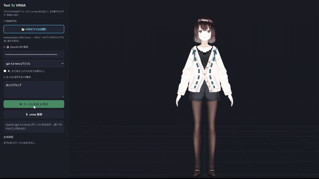

# Text-To-VRMA - VRM 특화 Text-To-Motion 도구

[](README.md) [](README_EN.md) [![简体中文](https://img.shields.io/badge/简体中文-lightgrey?logo=)](README_ZH-CN.md) [![한국어](https://img.shields.io/badge/한국어-blue?logo=)](README_KO.md) [](https://github.com/sponsors/Kirakun0328)

https://github.com/user-attachments/assets/f88743c3-6589-4427-94df-ab113b82ff4a



> 이 번역은 AI로 생성되었습니다. 수정 제안을 환영합니다!

텍스트를 입력하면 AI가 모션을 생성하고, **VRMA (VRM Animation / `.vrma`)** 파일을 브라우저 안에서 바로 만들어 그 자리에서 VRM 캐릭터를 움직이는 웹 애플리케이션입니다. 생성한 `.vrma` 파일은 저장해 두었다가 VRMA를 지원하는 앱에서 그대로 사용할 수 있습니다.

예시: "제자리에서 걷기", "기뻐서 점프하기", "손 흔들기", "슬픈 듯이 고개 숙이기"

## ✨ 주요 기능
- 📝 **텍스트로 모션 생성** (일본어 지원) - LLM 키프레임 / NVIDIA ARDY 두 가지 엔진 제공
- 🧠 **Jev (TypeSafe AI) 지원** - 입력 문장에서 감정, 시선, 동작 템포를 분석해 표정과 움직임의 스타일을 자동으로 보완합니다 (v1.1.9+)
- 🚀 **최신 모델 지원** - OpenAI GPT-6 세대 (`gpt-6-astra` / `gpt-6.1-sol` / `gpt-6-luna`), Claude Fable 5.1 / Opus 5.5 / Sonnet 5.5 / Haiku 5.5
- 💳 **Codex 구독 지원** - 데스크톱 버전뿐 아니라 로컬 웹 버전에서도 구독 사용량 한도로 직접 호출할 수 있습니다
- 🎬 생성한 모션을 **GIF / 동영상 (1080p)** 으로 내보내기 - SNS에 바로 공유할 수 있습니다
- 🎨 **배경색 자유 지정** - 그린 스크린 등 크로마키 합성용 단색 배경을 설정할 수 있습니다
- ⏱ **모션 길이를 초 단위로 지정** (비워 두면 자동 판정, "자동 보정" 옵션 제공)
- ▶ **재생 시크바** - 현재 재생 시간 표시, 원하는 지점으로 스크럽, 일시 정지
- 📍 **경유지 모드** - 3D 뷰의 바닥을 클릭해 이동 경로를 지정 (ARDY)
- 🎭 **감정을 몸으로 표현** - 표정뿐 아니라 자세, 팔, 무게중심, 움직임의 완급에도 반영
- 🔍 **AI 모션 리뷰** - 생성 후 AI가 보정 필요 여부를 판단하고, 필요할 때만 보정을 적용
- 🎯 **지시 반영 체크** - 이동, 점프, 웅크리기, 손 들기를 아바타 위에서 측정
- 🎲 **후보 3개 생성 및 비교** - 서로 다른 시드로 생성해 비교하고 가장 좋은 것을 선택
- ✨ **전신 부드러움 보정** - 급격한 각도 변화를 완화하면서 접지 부위는 보호
- 🔁 **루프 재생** - 시작과 끝을 이어 끊김 없이 재생
- 😊 **표정 자동 생성** + 4개 국어 UI (일본어 / 영어 / 중국어 / 한국어)
- 🔌 **OpenAI 호환 프로바이더 지원** - OpenRouter, DeepSeek, Ollama 등도 사용할 수 있습니다
- 🟣 **Claude API 지원** - Anthropic의 Claude (claude-opus-5-5 등)로도 모션을 생성할 수 있습니다
- 🧭 **연결 안내** - ARDY 엔진이 실행 중이 아닌 경우 등 연결에 실패하면, 원인과 함께 "엔진 시작" 등의 버튼을 표시합니다


생성 엔진은 두 가지 중에서 선택할 수 있습니다.

| 엔진 | 특징 | 필요 조건 |
| --- | --- | --- |
| **LLM 키프레임** (OpenAI API / Claude API / Codex / 호환 API) | 정확한 포즈, 손가락, 표정 지정에 강합니다. 별도 설정 없이 어떤 PC에서도 동작합니다. OpenAI 호환 API (OpenRouter, DeepSeek, Ollama 등)와 Anthropic의 Claude API도 지원합니다. | API 키 또는 Codex 플랜 |
| **ARDY 로컬 엔진** (v1.1+) | NVIDIA의 모션 생성 AI [ARDY](https://github.com/nv-tlabs/ardy)를 로컬에서 실행합니다. 걷기, 춤, 점프 같은 전신 동작이 **모션 캡처 수준의 품질**입니다. 생성 횟수 무제한, 오프라인 동작. | 추가 설정 필요 (아래 참조) |

ARDY 모드에서는 ARDY가 신체 모션을 생성합니다. Codex와 함께 사용하면 첫 번째 동작 구간의 신체와 표정을 설계한 뒤 생성과 재생을 시작하고, 그동안 후속 구간을 설계합니다. 확정된 구간의 시각과 내용은 그대로 유지하고 끝에 이어 붙입니다. "ARDY만 사용"은 입력 문장에서 바로 생성합니다. Jev의 분석은 보조 수단으로 병행하여 사용합니다. 일반적인 신규 생성은 서로 독립적이며, 생성 중에 다시 입력하거나 명시적으로 추가 수정을 하면 현재의 물리 이력에서 자연스럽게 이어집니다. 조작 방법과 제약 사항은 [ARDY 연속 생성](docs/ardy-realtime.md)을 참고하세요.

| 동작을 설계하는 AI | 필요 조건 | 비고 |
| --- | --- | --- |
| **ARDY만 사용** (기본값) | 없음 | ARDY 내장 번역으로 생성합니다. |
| **Codex 구독** | ChatGPT / Codex 플랜 | 설정 패널에 사용률, 남은 한도, 초기화 시각을 표시합니다. |
| **OpenAI API** | API 키 | GPT-6 Astra / GPT-6.1 Sol (기본값) / GPT-6 Luna |
| **Claude API** | API 키 | Fable 5.1 / Opus 5.5 (기본값) / Sonnet 5.5 / Haiku 5.5 |

- Codex를 사용한 연속 생성에서 인증이나 계획 수립에 실패하면 그 이유를 표시합니다. ARDY 단독이나 유료 API로 자동 전환하지는 않습니다. 직접 생성은 "ARDY만 사용"으로 선택할 수 있습니다.
- 생성 후 리뷰와 품질 설정은 [모션 품질의 작동 방식](#모션-품질의-작동-방식)을 참고하세요.

모션과 동시에 **표정** (미소, 슬픔, 놀람, 눈 깜빡임 등)도 생성됩니다.
눈 깜빡임 간격에는 자연스러운 편차를 주며, 놀란 표정일 때는 깜빡임을 억제합니다.
`.vrma` 파일을 저장할 때 "표정 포함 / 제외 (본 모션만)"를 선택할 수 있습니다.

UI는 **일본어 / 영어 / 중국어 / 한국어**를 지원하며, 오른쪽 상단의 선택기로 즉시 전환할 수 있습니다.
(처음 실행할 때는 브라우저의 언어 설정에 따라 자동으로 결정됩니다.)
*The UI is available in Japanese, English, Chinese and Korean - switch instantly from the selector at the top.*

## 설치 및 실행

> 🎁 **빌드 없이 바로 사용하고 싶은 Windows 사용자:**
> [Releases에서 최신 zip 다운로드](https://github.com/Kirakun0328/text-to-vrma/releases/latest)
> - 압축을 풀고 exe를 더블클릭하기만 하면 됩니다 (설치 불필요, ARDY 엔진 설정 일체도 포함되어 있습니다).
> 아래의 설정 과정은 모두 필요 없습니다.

소스에서 실행하는 방법은 두 가지입니다. 잘 모르겠다면 **A. 브라우저 버전**이 가장 빠릅니다.

| | 실행 명령 | 추천 대상 |
| --- | --- | --- |
| **A. 브라우저 버전** | `npm run dev` | 우선 한번 써 보고 싶은 분 (모든 OS, 최소 3개 명령) |
| **B. 데스크톱 버전 (Electron)** | `npm run build` → `npm run app:dev` | Codex 구독 인증이나, 앱 내 ARDY 엔진 설정 및 자동 실행을 사용하고 싶은 분 |

**사전 준비 사항:**

| 하려는 작업 | 필요 조건 |
| --- | --- |
| 공통 | Node.js 20+, git |
| 모션 생성 (LLM 키프레임) | OpenAI API 키 ([platform.openai.com](https://platform.openai.com/)에서 발급) 또는 Claude API 키 ([console.anthropic.com](https://console.anthropic.com/)에서 발급). 로컬 웹 버전과 데스크톱 버전에서는 대신 Codex와 ChatGPT/Codex 플랜을 사용할 수도 있습니다. |
| ARDY 로컬 엔진 (선택) | 아래의 [ARDY 로컬 엔진 섹션](#ardy-로컬-엔진-선택-사항) 참조 (Python 3.10+ / git, 약 20GB 다운로드). **이쪽은 API 키 없이도 동작합니다.** |

VRM 모델로는 [VRoid 공식 샘플 모델 (AvatarSample)](https://hub.vroid.com/characters/2843975675147313744/models/5644550979324015604)의 VRM 1.0 버전과 VRM 0.0 버전이 포함되어 있으며, 실행 시 VRM 1.0 버전이 로드됩니다. 가지고 있는 `.vrm` 파일로 교체할 수도 있으며, **0.x와 1.0 형식을 모두 지원**합니다 (three-vrm이 자동으로 판별하고 방향도 정규화합니다).


### A. 브라우저 버전

```sh
git clone https://github.com/Kirakun0328/text-to-vrma.git
cd text-to-vrma
npm install
npm run dev
# → 브라우저에서 http://localhost:5173 을 엽니다
```

### B. 데스크톱 버전 (Electron)

```sh
git clone https://github.com/Kirakun0328/text-to-vrma.git
cd text-to-vrma
npm install
npm run build
npm run app:dev
```


- Electron 버전은 Vite 빌드 결과물(`dist/index.html`)을 로드합니다. 처음 실행할 때와 소스 코드를 변경한 후에는 **반드시 `npm run build`를 실행한 다음** `npm run app:dev`로 시작하세요
  (이미 빌드된 상태에서 다시 시작하기만 한다면 `npm run app:dev`만 실행해도 됩니다).
- Codex 구독 인증은 데스크톱 버전과 로컬 웹 버전(`npm run dev` / `npm run preview`)에서 사용할 수 있습니다.

  사용하려면 미리 Codex CLI의 설치, 인증, PATH 설정을 마쳐 주세요
  (Codex CLI는 앱에 포함되어 있지 않습니다).
  설치되어 있지 않거나 버전이 오래된 경우, 앱에서 설치 및 업데이트 방법을 안내합니다
  (v0.153.3에서 동작 확인).
  로컬 웹 버전은 동일 출처(same-origin)의 Node 서버를 통해 `codex app-server`에 연결합니다.
  정적 파일만 제공하는 환경에서는 사용할 수 없습니다. 모델 목록은 로그인한 계정에서 가져오며, GPT-6 Astra가 목록에 없다면 아직 구독 쪽에서 선택할 수 없는 상태입니다.
  소스 버전에서 `npm install`을 실행하면 동작이 확인된 Codex CLI 0.153.3도 함께 설치됩니다.
  프로젝트 내부의 CLI를 우선 사용하며, 없을 때만 PATH에 있는 CLI를 사용합니다.
  오래된 CLI에서는 사용 가능한 Astra 모델이 목록에 나타나지 않을 수 있습니다 (0.144.1과 0.153.3에서 확인).

> [!NOTE]
> 현재 `npm run app:build` (exe 생성)는 Windows Portable 버전 전용입니다. macOS용 `.app`이나 `.dmg` 파일은 생성하지 않습니다.

## 사용 방법

1. 실행하면 샘플 모델 (AvatarSample VRM 1.0 버전)이 로드됩니다.

   "VRM 파일 열기"를 클릭하거나 3D 뷰에 드래그 앤 드롭하여 가지고 있는 VRM으로 교체할 수 있습니다.
2. 생성 엔진 선택
   - **OpenAI API 키**: 키를 입력하고 모델을 선택합니다. 키는 브라우저의
     localStorage에만 저장되며, OpenAI 외의 곳으로는 전송되지 않습니다.
     "🔌 OpenAI 호환 프로바이더 사용"에서 베이스 URL과 모델 이름을 지정하면
     OpenRouter, DeepSeek, Ollama 등의 호환 API도 사용할 수 있습니다.
     모델 목록에서 **GPT-6 Astra** (`gpt-6-astra`)도 선택할 수 있습니다.
     생성, 자기 수정, ARDY의 동작 계획에 사용할 수 있으며, 기본 모델은 `gpt-6.1-sol`입니다.
     [OpenAI 공식 모델 정보](https://developers.openai.com/api/docs/models/gpt-6-astra)에 따르면
     단계적으로 제공되고 있으므로, 사용하는 API 프로젝트에 접근 권한이 있어야 합니다.
     로컬 HTTP API에서는 요청의 `model`에 `gpt-6-astra`를 지정하거나
     환경 변수 `OPENAI_MODEL=gpt-6-astra`를 설정할 수 있습니다.
   - **Claude API**: Anthropic의 Claude API 키 (`sk-ant-...`)를 입력하고 모델을 선택합니다
     (`claude-fable-5-1` / `claude-opus-5-5` / `claude-sonnet-5-5` / `claude-haiku-5-5`).
     키는 브라우저의 localStorage에만 저장되며, Anthropic 외의 곳으로는 전송되지 않습니다.
     Claude API 지원은 [@AUDOSt0ck1ng](https://github.com/AUDOSt0ck1ng) 님의 기여
     ([#9](https://github.com/Kirakun0328/text-to-vrma/pull/9))로 이루어졌으며, **기여자가 브라우저 버전과 데스크톱 버전 모두에서 동작을 확인했지만, 작성자 환경에서는 확인되지 않았습니다**.
     버그 리포트와 동작 확인 피드백을 환영합니다.
   - **Codex 구독 (데스크톱 및 로컬 웹 버전)**: "ChatGPT로 로그인"을 클릭하면
     기본 브라우저에서 인증합니다. 이미 Codex CLI로 로그인되어 있다면 그 인증 정보를 재사용합니다.
   - **ARDY 로컬 엔진**: 로컬에서 동작하는 모션 생성 AI (아래 섹션 참조)
3. 텍스트로 동작을 지시하고 "▶ 모션 생성 & 재생"을 클릭합니다 (Ctrl+Enter도 사용 가능)
   - "⏱ 길이 (초)"로 모션 길이를 지정할 수 있습니다 (비워 두면 자동 판정).
   - "길이 자동 보정"을 켜면 동작 수에 맞는 자연스러운 길이로 자동 조정합니다.
   - "루프 재생"에서 자동 / 항상 루프 / 한 번만 재생 중에서 선택할 수 있습니다.
   - "🔍 자기 수정" (LLM 모드)은 생성 후 한 번 더 패스를 거쳐 품질을 높입니다.
   - **연기 설계 + 이미지 리뷰**: Codex (구독 사용량 한도) 또는 공식 GPT-6 Astra API로 사용할 수 있습니다.
     연기의 흐름, 지지 다리, 무게중심, 시선, 손발의 도달 위치를 계획하고, 로드한 VRM의 실제 치수를 사용해 생성합니다.
     정면과 측면의 프레임 단위 이미지와 측정된 위치를 모델에 다시 보내 한 번 수정합니다 (총 3회 생성).
     API 모드는 종량제 과금이며, Codex 모드는 ChatGPT 로그인이 필수이고 API 키로 자동 전환되지 않습니다.
     1~15초를 지원합니다. "일반 자기 수정" 대신 실행됩니다.
     완료 후 비교 패널에서 수정 전/후를 재생하고, 연기 설계, 측정값, 전송된 이미지를 확인할 수 있습니다.
     지표가 크게 악화된 후보는 자동으로 채택하지 않지만 비교용으로 남겨 둡니다. 측정값이 물리적 품질을 보장하지는 않습니다.
     "속도 우선"은 추론량과 키 수를 줄이고, "품질 우선"은 더 꼼꼼하게 생각합니다.
     수정이 완료되기 전에 초안을 먼저 재생합니다. 비교 패널에 초안까지 걸린 시간과 전체 소요 시간을 표시합니다.
4. 생성된 동작이 3D 뷰에서 재생됩니다
   - 하단의 **재생 바**에서 현재 재생 시간 확인, 원하는 지점으로 스크럽, 일시 정지를 할 수 있습니다.
   - 오른쪽 상단의 **카메라 초기화 / 전체 화면**과 하단의 **배경 전환**으로 미리보기를 조정할 수 있습니다.
5. "4. 내보내기 & 공유"에서 출력
   - **⬇ .vrma 저장** - VRMA 지원 앱 (VRoid Hub, cluster 등)에서 사용할 수 있는 파일
   - **🎞 GIF 내보내기 / 🎬 동영상 내보내기** - 1080p로 내보내 SNS에 바로 공유
   - 생성 기록의 각 항목에서도 재생, 저장, GIF/동영상 내보내기를 할 수 있습니다.


## 모션 품질의 작동 방식

생성된 모션을 그대로 출력하지 않고, 여러 단계에 걸쳐 품질을 높이고 있습니다.
다만 이 모두는 **기하학적 측정에 기반한 보조 수단이며, 품질을 보장하지는 않는다**는 점에 유의하세요.

### 생성 품질

"표준", "속도 우선", "품질 우선" 중에서 선택할 수 있습니다 (기본값은 표준).
계획 단계의 추론량과 리뷰 횟수가 달라집니다. 속도 우선은 추론량을 줄이고, 품질 우선은 꼼꼼하게 생각한 뒤 최대 2회까지 재평가를 수행합니다.

### 종료 자세 유지

연속 생성에서는 각 구간에서 움직이지 않아야 할 부위를 고정합니다. 내리고 있던 팔은 몸통이 기울어도 중력 방향으로 늘어진 상태를 유지하며, "팔을 내리며 끝나는" 구간에서는 아직 올라가 있는 팔만 움직입니다. 공중에서 시작하는 구간은 다리와 허리의 상하 움직임을 만들어 착지시킵니다.
자세한 내용은 [종료 자세 유지](docs/end-pose-holding.md)를 참고하세요.

### AI 모션 리뷰

생성 후 AI가 **먼저 보정이 필요한지 판단**합니다. 필요 없다면 원래 동작을 그대로 채택하고, 그 이유를 미리보기의 "보정 전후 비교"에 표시합니다.

- **표준 & 품질 우선** - 원본 모션의 관절에 보정을 직접 적용하고, 별도의 판정으로 재평가합니다.

- **속도 우선** - ARDY에 보낸 지시를 검토하여 다시 생성합니다.

- **이미지도 사용** - 앱이 생성된 모션의 정면과 측면 사진을 자동으로 촬영해 선택한 AI에 보냅니다.

  (사용자가 참고 이미지를 직접 준비할 필요는 없습니다.)

자동 보정은 기본적으로 꺼져 있습니다. 생성 후 "이 동작 보정하기"에서 수동으로 실행할 수 있습니다.
물리 지표가 악화되거나 요청한 동작이 사라진 경우에는 자동으로 채택하지 않습니다.
ARDY의 종료 자세는 유지되며, 발 미끄러짐을 유발하는 강제적인 직립 보간은 하지 않습니다.

| | |
| --- | --- |
| 지원 길이 | 1~15초 (웹 버전 및 데스크톱 버전 기능) |
| AI에 전달하는 정보 | 발 미끄러짐, 관절 각속도, 손발의 속도와 가속도 |
| 발 미끄러짐 측정 방법 | 발 높이와 상하 속도로 접지를 근사합니다. **물리 시뮬레이션이나 전신 충돌 판정이 아닙니다.** |

### 지시 반영 체크

이동, 두 발 점프, 허리 낮추기, 얼굴 근처까지 손 들기의 4가지 동작을 아바타 위의 관절 위치를 최대 20Hz로 측정하여 감지합니다.

이는 **기하학적 대리 지표**입니다. 정확한 걸음 수, 이동 방향, 동작 순서, 표정, 자연스러움, 충돌, 물리적 안정성을 보장하지는 않습니다.

### 후보 3개 생성 및 비교

비교하고 싶다면 서로 다른 시드로 후보 3개를 생성해 나란히 비교할 수 있습니다 (일반적으로는 후보 1개).
비교 가능한 체크 항목이 갖춰진 경우에는 감지 수를 우선하며, 발 미끄러짐과 파묻힘도 함께 확인합니다.
추가적인 AI 계획 호출은 발생하지 않지만, ARDY의 생성 시간은 늘어납니다.


### 전신 부드러움 보정

급격한 각도 변화를 완화합니다 (기본값 ON, "모션 상세 설정"에 있습니다).
팔과 상체뿐 아니라 다리, 발목, 허리, 손가락도 대상입니다.

발목 높이로 접지를 추정하며, **발이 낮은 구간에서는 보정을 줄여 이동 경로를 유지합니다**.
이는 발목 높이에 기반한 추정이며, 실제 아바타의 발바닥 접촉을 측정하는 IK 고정이 아닙니다.
계단, 단차, 특수한 자세에서의 접지 판정이나 발 미끄러짐의 완전한 방지는 보장하지 않습니다.

### 루프 재생

반복 횟수가 정해져 있거나 마무리 동작이 있는 경우에는 자동으로 루프하지 않고 마지막 포즈를 유지합니다.
명시적으로 루프시키는 경우에는 시작과 끝을 겹쳐서 연결합니다.
이동을 동반하는 루프에서는 위치와 방향을 누적하여, 주기마다 원점으로 돌아가는 문제를 억제합니다.

> 이 연결 처리는 **뷰어 내 재생 전용**입니다. 내보낸 `.vrma` 파일에는 같은 처리가 적용되지 않습니다.

## ARDY 로컬 엔진 (선택 사항)

NVIDIA Research의 text-to-motion 모델
[ARDY](https://research.nvidia.com/labs/sil/projects/ardy/) (SIGGRAPH 2026)를
로컬에서 실행해 모션 캡처 수준의 전신 모션을 생성하는 모드입니다.

**할 수 있는 것:**

- 걷기, 달리기, 춤, 점프, 격투 같은 전신 동작을 실제 사람의 모션 캡처 데이터로 학습한 AI가 생성합니다 (무게중심 이동, 기세, 발의 접지가 실제처럼 보입니다).
- **일본어 프롬프트 지원** - 로컬 번역 (FuguMT)으로 자동으로 영어로 번역합니다.
  OpenAI API 키가 저장되어 있으면 GPT가 영어 번역과 연속 동작 분할까지 처리해 정확도가 높아집니다.
- **📍 경유지 모드** - 3D 뷰의 바닥을 클릭해 경유지를 배치하면, 캐릭터가 그 순서대로 지나가는 모션을 생성합니다 (오른쪽 클릭으로 하나씩 취소).
- "걷다가 달리고 점프하고 넘어지기" 같은 **여러 단계의 동작**도 GPT가 분할하고 검증하여, 최대 12개 동작까지 이어서 생성합니다 (API 키 저장 시).
- 모션 길이는 초 단위 (0.1초 이상)로 지정하거나 내용에 따라 자동으로 결정할 수 있습니다. 표정과 루프 여부도 자동으로 결정됩니다.
- 생성 횟수 무제한, 완전한 로컬 실행 (설정 후에는 오프라인으로 동작).


**시스템 요구 사항 및 성능:**

| | 최소 | 권장 |
| --- | --- | --- |
| OS | Windows 10/11 64-bit, macOS, Linux | 왼쪽과 동일 |
| RAM | 16GB | 32GB+ |
| 디스크 | 35GB | 왼쪽과 동일 |
| GPU | VRAM 4GB 이상 (GPU가 없어도 CPU로 1회 생성에 수십 초) | NVIDIA GPU 6GB+ (1회 생성에 몇 초) |

> 💡 **ARDY 공식 데모는 VRAM 20~24GB를 요구하지만, 이 앱은 모션 모델 본체의 VRAM 사용량을 실측 기준 약 1.2GB까지 줄였습니다** (VRAM의 대부분을 차지하는 텍스트 이해 부분인 8B LLM을 CPU 쪽에서 실행하는 구성이기 때문입니다). 생성 중에도 VRAM은 거의 늘어나지 않습니다 (실측: +약 12MiB).
> 모션 모델 본체와 확산 스텝 수는 공식 버전과 동일하므로 **생성 품질은 전혀 떨어지지 않습니다**.
> * 수치는 `nvidia-smi`로 실측한 값입니다 (프로세스 중지/시작 시의 VRAM 차이).
> 모델 사용량은 약 1.2GB이며 생성 중에도 늘어나지 않으므로, 데스크톱 화면 표시분을 더해도 **VRAM 4GB GPU에서 충분히 동작할 것으로 예상됩니다** (동작 확인은 12GB에서 진행했으며, 4~6GB는 검증되지 않았으므로 6GB 이상을 권장합니다).
> GPU가 없어도 CPU로 동작합니다 (단, 생성 속도가 몇 배 느려집니다).

**품질을 뒷받침하는 3계층 구조** - 역할 분담은 "GPT는 두뇌, ARDY는 몸":

| 계층 | 역할 |
| --- | --- |
| GPT (선택 / API 키 저장 시) | 일본어 의도 이해, 연속 동작 분할, ARDY가 잘 처리하는 영어 표현으로 바꿔 말하기 |
| Llama-3-8B (로컬 / CPU) | 영어 문장을 ARDY 전용 벡터로 변환 (LLM2Vec) |
| ARDY (로컬 / GPU) | 실제 모션 캡처 데이터로 학습한 AI가 동작을 생성 |

API 키가 없어도 로컬 번역 (FuguMT)만으로 모든 과정을 처리할 수 있지만, 키가 있으면 "달린 다음 점프하고, 마지막에 인사하기" 같은 복잡한 지시의 재현 정확도가 높아집니다.

**설정** (Python 3.10+와 git이 필요하며, 약 20GB를 다운로드합니다):

Windows:

```powershell
powershell -ExecutionPolicy Bypass -File tools\ardy-engine\install.ps1
```

macOS:

```bash
bash tools/ardy-engine/install_mac.sh
```

Linux:

```bash
bash tools/ardy-engine/install_linux.sh
```

Linux 버전은 `apt`, `dnf`, `yum`, `pacman`, `zypper`를 지원하며, 필요에 따라 Python 3.10+, git, C++ 빌드 도구 (`gcc`/`g++`, `cmake`)를 자동으로 설치합니다 (패키지 설치에는 `sudo`를 사용합니다).
NVIDIA GPU가 있으면 CUDA 버전의 PyTorch를 자동으로 선택합니다 (`nvidia-smi`로 판별).
브라우저 버전에서 사용하는 경우, 설정 완료 시 표시되는 `server.py` 실행 명령으로 엔진을 수동으로 시작하세요.

macOS에 Homebrew가 설치되어 있지 않으면 설정 중에 자동으로 설치됩니다.
macOS 지원은 [@emadurandal](https://github.com/emadurandal) 님 ([#2](https://github.com/Kirakun0328/text-to-vrma/pull/2)), Linux 지원은 [@mouseos](https://github.com/mouseos) 님 ([#7](https://github.com/Kirakun0328/text-to-vrma/pull/7))의 기여로 이루어졌습니다.
**개발자 (작성자)가 동작을 확인한 환경은 Windows뿐이며, macOS와 Linux는 작성자 환경에서 확인되지 않았습니다**
(macOS와 Linux는 각 기여자가 실제 기기에서 동작을 확인했습니다).
이러한 환경에서의 버그 리포트, 동작 확인 피드백, 수정 PR을 환영합니다.

설정이 완료되면 엔진을 시작한 뒤 앱에서 "ARDY 로컬 엔진" 모드를 선택하세요.
자세한 내용, 수동 실행 방법, API는 [tools/ardy-engine/README.md](tools/ardy-engine/README.md)를 참고하세요.

이 기능은 Meta Llama 3를 텍스트 인코더로 사용합니다. **Built with Meta Llama 3**

## Jev (TypeSafe AI)를 이용한 의미 및 감정 분석 (선택 사항)

[Jev](https://typesafe.ai/)는 TypeSafe AI의 "System One 모델"입니다. 텍스트를 생성하는 LLM과 달리, 입력 문장을 타입이 지정된 선택지와 점수로 빠르게 분류하는 모델입니다.
Text-To-VRMA에서 **Jev는 모션 자체를 만들지 않습니다**. Jev의 역할은 어디까지나 다음 항목을 분석하는 것입니다.

- 입력 문장의 감정 (`emotion`)과 그 강도 (`emotion_intensity`)

- 각 감정의 독립 점수 (`affect`)와 항목별 신뢰도 (`confidences`)

- 에너지량 (`movement_energy`), 동작의 규모, 템포, 대인 태도, 명시된 시선

그리고 그 결과를 **보조 정보로서** 생성 프롬프트에 전달합니다 (ARDY, OpenAI, Claude, Codex 공통). 원문을 우선하며 동작의 종류를 고정하지 않습니다. 기존 분류인 `reaction`은 분석 API 호환용이며, 신체 동작 생성에는 전달하지 않습니다. 독립 감정 점수는 선행 표정에도 사용되며, ARDY의 얼굴 표정이 설계되지 않은 경우에는 짧은 시작 표정으로 VRMA에 보완합니다.
기존 표정 트랙과 도중의 감정 변화는 그대로 유지됩니다.

**Jev API 키가 있으면 자동으로 사용합니다.** 설정되지 않았거나, 오류가 발생하거나, 타임아웃이 되면 Jev 없이 생성을 계속합니다. 전체 신뢰도가 낮더라도 분석 결과 전체를 버리지 않고, 각 항목의 신뢰도에 따라 처리합니다.
Codex와 함께 사용하는 연속 생성에서는 구간 설계와 Jev 분석을 병행하며, 첫 번째 신체 및 표정 구간이 확정되면 ARDY를 시작합니다.
후속 계획은 끝에 이어 붙이고, 나중에 도착한 Jev 분석 결과는 아직 재생되지 않은 구간의 생성 조건에 전달합니다. 이미 재생된 동작이나 Codex가 설계한 표정을 덮어쓰지 않습니다.

### 활성화 방법

- **앱 / 브라우저 버전**: 설정 항목 (언어 선택기 왼쪽, 다른 API 키와 같은 줄)에 Jev API 키를 입력하고 모델 (`jev-latest` / `jev-preview` / `jev-1.13.0`)을 선택합니다. 변경 사항은 자동으로 저장됩니다.
- **로컬 HTTP API (`npm run api`)**: `.env` 파일에 `JEV_API_KEY`를 설정합니다.
  `JEV_ENABLED=false`로 설정하면 서버 전체에서 명시적으로 비활성화할 수 있습니다 (`.env.example` 참조).

### 일본어는 영어로 번역한 후 분석합니다

Jev는 주로 영어를 대상으로 하며, TypeSafe AI 문서에서도 다른 언어는 정확도가 떨어진다고 설명하고 있습니다. 그래서 일본어 입력은 ARDY 엔진에 내장된 번역 모델 (FuguMT)로 먼저 영어로 번역한 뒤 Jev에 보냅니다. ARDY 엔진이 실행 중이 아니거나 번역이 2초 이내에 끝나지 않으면, 기존과 마찬가지로 원문을 그대로 보냅니다. 설정의 "Jev에는 영어로 번역하여 전송"에서 이 기능을 끌 수 있습니다
(로컬 HTTP API에서는 환경 변수 `JEV_TRANSLATE=0`). 동작을 설계하는 AI (Astra, Claude 등)에는 일본어 텍스트를 그대로 전달합니다.

### API 키 취급

OpenAI 및 Claude 키와 같은 방침을 따릅니다. 앱에서는 키를 `localStorage`에 저장하고, Electron IPC 또는 동일 출처의 로컬 연결 서버를 거쳐 Jev (`https://api.typesafe.ai`)로 전송합니다. 소스 코드에 하드코딩되어 있지 않으며, 로그에도 출력하지 않습니다 (분석 결과 로그에는 감정, 반응, 신뢰도만 남기고 API 키와 입력 전문은 남기지 않습니다).


### 로컬 HTTP API에서 사용하기

`POST /v1/motions`의 `use_jev`는 선택적인 불리언 값입니다. 생략하면 서버에 키가 있을 때 자동으로 사용하며, `false`로 지정하면 해당 요청에 한해 분석을 건너뜁니다.

```bash
curl -X POST http://127.0.0.1:8787/v1/motions \
  -H "Content-Type: application/json" \
  -d '{"prompt":"Yay! It is finally finished!!","engine":"ardy","use_jev":true}'
```

모션은 생성하지 않고 분석 결과만 필요하다면 전용 엔드포인트를 사용할 수 있습니다.

```bash
curl -X POST http://127.0.0.1:8787/v1/motion-context \
  -H "Content-Type: application/json" \
  -d '{"text":"Eh!? Really!?"}'
# => {"emotion":"surprise","emotion_intensity":0.8,"reaction":"startled", ...}
```


`use_jev`는 서버 측에 `JEV_API_KEY`가 설정되어 있고 명시적으로 비활성화되지 않은 경우에만 실제로 동작합니다. 요청 측에서 API 키를 전달하거나 운영자의 설정을 덮어쓸 수는 없습니다. 기존의 Host/Origin/토큰 검증도 이 두 엔드포인트에 동일하게 적용됩니다.

### 네트워크 통신에 관하여

Jev를 활성화하면 입력 텍스트 (최대 2000자로 잘림)가 TypeSafe AI API (`https://api.typesafe.ai`)로 전송됩니다. 신규 생성 시에는 이전 연기 상태를 보내지 않습니다.
명시적인 추가 수정 시에는 현재 동작, 자세, 표정, 재생 위치에 관한 제한된 상태 정보도 함께 전달합니다.

전달 경로, 지연 도착, 신체 동작에의 적용 여부는 생성 spec의 `jevContext`, `jev`, `realtime.jev`에 기록됩니다.
경로와 제약 사항은 [생성 파이프라인으로의 Jev 통합](docs/jev-generation-integration.md)을 참고하세요.

## 아키텍처


```text
[LLM Keyframe Mode]
Text ── OpenAI API / Codex CLI ──▶ Motion Spec (Bone-specific Euler angle keyframe JSON)

[ARDY Mode]
Text ── Selected AI (Acting Planning & Action Splitting) ──▶ ARDY Engine Server (localhost:2337)
            │  Codex / OpenAI / Claude         │ Generates 20fps motion via diffusion model
            └ No AI -> ARDY Built-in Translation │ → Foot Slide Correction → VRM Retargeting
                                               ▼
                                     Motion Spec ──▶ Smoothness Correction ──▶ AI Review (Optional)
```

spec 이후의 과정은 두 모드가 공통입니다.

```text
                         Motion Spec
                              │
                              ▼
              vrmaBuilder.js ── glTF + VRMC_vrm_animation Extension → GLB (.vrma)
                              │
                              ▼
              viewer.js ── Plays back on VRM using three.js + @pixiv/three-vrm-animation
```


| 파일 | 역할 / 설명 |
| --- | --- |
| `src/llm.js` | OpenAI API용 프롬프트 (본 규약 / 샘플 모션 5종) / 2패스 자기 수정 / spec 검증 및 각도 클램핑 |
| `src/vrmaBuilder.js` | 모션 spec으로 VRMA (GLB) 바이너리를 생성합니다. VRM 1 규약의 T 포즈 골격을 포함하고, `VRMC_vrm_animation` 확장으로 휴머노이드 본을 매핑합니다 |
| `src/viewer.js` | three.js 씬 / VRM 로드 / VRMA 재생 |
| `src/idleMotion.js` | 대기 모션 (호흡) |
| `src/main.js` | UI 연결 |
| `src/autoExpressions.js` | ARDY 모드용: 감정 단어에 따른 표정 자동 부여 + 눈 깜빡임 (복합 감정 및 시간 순서에 따른 감정 지원) |
| `src/emotionActing.js` | 감정을 신체 동작에 반영하기 위한 공통 지침 (계획, 생성, 리뷰에서 공유) |
| `src/smoothMotion.js` | 전신 부드러움 보정. 발목 높이로 접지를 추정하고, 접지 부근에서는 보정을 억제합니다 |
| `src/motionCompliance.js` | 지시 반영 체크. 이동, 점프, 웅크리기, 손 들기를 아바타 위에서 측정합니다 |
| `src/ardyCandidates.js` / `src/candidatePanel.js` | 후보 3개의 생성, 비교, 선택 |
| `src/motionReview.js` / `src/ardyReview.js` | 생성 후 AI 리뷰 (보정 필요 여부 판단 포함) |
| `src/directMotionReview.js` / `src/motionPatch.js` | 관절을 직접 보정하는 경로와 그 적용 및 검증 |
| `src/segmentedReview.js` | 긴 동작을 약 15초 단위 구간으로 나누어 보정 |
| `src/motionAssessment.js` | 발 미끄러짐, 파묻힘 등 물리 지표 계산 |
| `src/reviewCapture.js` | 생성된 모션의 정면과 측면을 자동 촬영 (이미지 리뷰용) |
| `src/motionCheckPanel.js` / `src/reviewI18n.js` | 재생 상태, 생성 경로, 체크 결과의 표시 및 다국어화 |
| `src/loopPlayback.js` | 루프 재생 시 시작과 끝을 연결하는 처리 |
| `src/codexWebBridge.js` / `src/codexUsage.js` | 로컬 웹 버전의 Codex 연결 및 사용량 한도 표시 |
| `tools/codex-web.mjs` | Vite 개발 서버에서 `codex app-server`로 요청을 중계하는 플러그인 |
| `electron/codex-client.cjs` | Codex app-server 연결 / ChatGPT 인증 / 모델 조회 / 임시 스레드에서의 생성 |
| `electron/ardy-client.cjs` | ARDY 엔진 서버 시작 및 모니터링 (데스크톱 버전) |
| `electron/preload.cjs` | 인증 정보를 노출하지 않는 제한된 IPC 브리지 |
| `src/apiServer.js` | 로컬 HTTP API 본체 (OpenAI와 ARDY 엔진 모두 지원) |
| `tools/api-server.mjs` | API 서버 시작 엔트리 (`npm run api`) |
| `tools/ardy-engine/server.py` | ARDY 상주 서버: 생성, 일본어 번역, 경유지 제약, 진행 상황 API |
| `tools/ardy-engine/retarget.py` | ARDY Core 스켈레톤 → VRM Humanoid 리타기팅 |
| `tools/ardy-engine/install.ps1` | 원커맨드 엔진 설정 (Windows) |
| `tools/ardy-engine/install_mac.sh` | macOS용 원커맨드 엔진 설정 |
| `tools/ardy-engine/install_linux.sh` | Linux용 원커맨드 엔진 설정 |


## 모션 spec 형식
LLM이 생성하는 중간 표현입니다.

```json
{
  "name": "wave",
  "duration": 2.6,
  "loop": true,
  "tracks": {
    "rightUpperArm": [
      { "t": 0, "r": [0, 0, 70] },
      { "t": 0.4, "r": [0, 0, -45] }
    ]
  },
  "hips": [ { "t": 0, "p": [0, 0, 0] } ]
}
```

- `r` = T 포즈 기준의 오일러 각 [X, Y, Z] (도) / `p` = 허리(Hips) 위치 오프셋 (미터)
- `expressions` = VRM 프리셋 표정 (happy, blink 등)의 가중치 (0~1).
  미리보기에서는 항상 재생되며, `.vrma` 파일 저장 시 포함 여부를 선택할 수 있습니다
  (재생하는 앱이 VRMA 표정 트랙을 지원해야 합니다).
- 좌표 규약: 모델은 +Z 방향을 바라보며 / +X가 왼손 쪽입니다 (VRM 1.0 준거).

## 로컬 HTTP API (개발자용 실험적 기능)

> **v1.1.7에서 추가된 실험적 기능입니다.** 특히 ARDY 엔진을 통한 생성은
> 검증이 충분하지 않으며, 인터페이스가 향후 변경될 수 있습니다.
> **실제로 사용해 보신 후기와 버그 리포트를 적극 환영합니다** -
> [Issues](https://github.com/Kirakun0328/text-to-vrma/issues)에 편하게 올려 주세요.

다른 애플리케이션이나 스크립트에서 Text-To-VRMA를 호출하기 위한 로컬 API 서버입니다.
Unity, Blender, 자체 제작 도구, 셸 스크립트 등에서 텍스트를 보내고 모션 spec이나 `.vrma` 파일을 받을 수 있습니다.


```bash
cp .env.example .env   # 최초 1회만. OPENAI_API_KEY를 설정합니다 (ARDY만 사용한다면 불필요)
npm run api            # http://127.0.0.1:8787 에서 서버 시작
```

`.env`를 리포지토리 루트 바로 아래에 두면 시작 시 자동으로 읽어 들입니다 (Git에는 추적되지 않습니다).
시작하면 현재 어떤 엔진을 사용할 수 있는지 표시됩니다.

```text
Loaded .env
Text-To-VRMA API listening on http://127.0.0.1:8787
  engine=openai : Not configured (Please set OPENAI_API_KEY in .env)
  engine=claude : Not configured (Please set ANTHROPIC_API_KEY in .env)
  engine=ardy   : Available (ARDY-Core-RP-20FPS-Horizon40 / GPU)
```

`engine=ardy`는 **API 키 없이 사용할 수 있습니다** (ARDY 로컬 엔진을 실행해야 합니다).
`engine=openai` / `engine=claude`는 키가 필요하지만, ARDY 설정은 필요하지 않습니다.

### 데스크톱 앱에서 사용하기 (v1.1.7+)

CLI 명령을 사용하지 않고도 앱의 "고급 설정 → 로컬 HTTP API"에서 활성화할 수 있습니다.
**기본값은 비활성화**이며, 체크했을 때만 127.0.0.1에 포트를 엽니다.

- 앱에 이미 설정된 OpenAI / Claude 키를 그대로 사용하므로 중복 설정이 필요 없습니다.
- **액세스 토큰이 필수입니다**. 설정 항목에 표시되므로 호출하는 쪽에서 `Authorization: Bearer <token>`으로 지정하세요. 설치마다 고정된 값이므로 외부 도구에서는 한 번만 설정하면 됩니다. 유출된 경우 "🔄 재생성"으로 무효화할 수 있습니다.
- 포트가 사용 중이면 알림이 표시됩니다 (다른 포트를 지정하세요).

```bash
curl -X POST http://127.0.0.1:8787/v1/motions \
  -H "Authorization: Bearer <token displayed in app>" \
  -H "Content-Type: application/json" \
  -d '{"prompt":"walk forward and wave hand","engine":"ardy","format":"vrma"}' \
  -o walk.vrma
```

### 보안

**기본적으로 127.0.0.1에서만 수신 대기**하므로, 같은 PC의 앱에서만 접근할 수 있습니다.
외부에 공개하는 경우 `TEXT_TO_MOTION_API_TOKEN` 설정이 필수이며, 설정하지 않으면 시작 시 오류가 발생합니다 (이 경우 모든 요청에 `Authorization: Bearer <token>`이 필요합니다).

| 엔드포인트 | 설명 |
| --- | --- |
| `GET /health` | 가동 상태, 사용 가능한 엔진, 키 설정 여부 |
| `GET /openapi.json` | OpenAPI 3.1 정의 |
| `POST /v1/motions` | 텍스트로 모션 생성 |
| `POST /v1/vrma` | 기존 spec을 `.vrma`로 변환 (키 불필요) |
| `POST /v1/motion-context` | Jev로 의미와 감정만 분석 (Jev 설정 시에만. 아래 참조) |

`POST /v1/motions` 요청:

| 필드 | 기본값 | 설명 |
| --- | --- | --- |
| `prompt` | (필수) | 동작 지시. 1~4,000자 |
| `engine` | `openai` | `openai` / `claude` / `codex` = LLM 키프레임 / `ardy` = ARDY 로컬 엔진 |
| `planner` | `codex` | `ardy` 전용: 동작 계획에 사용할 AI (`codex` / `openai` / `claude` / `none`) |
| `speed` | - | `openai` / `codex`: `fast` / `balanced` / `quality`. `fast`는 추론량과 키 수를 줄입니다 |
| `format` | `json` | `json`은 spec을, `vrma`는 `.vrma` 바이너리를 반환 |
| `model` | 환경 변수 | `openai`/`claude`에서는 생성 모델, `ardy`에서는 동작 분할에 사용할 GPT 모델 |
| `refine` | `true` | `openai`와 `claude`에서 유효한 2패스 자기 수정 |
| `duration` | - | `ardy` 전용: 생성할 길이 (초) |
| `waypoints` | - | `ardy` 전용: 이동 경로 `[{ "x": 1, "z": 2 }]` |
| `use_jev` | 키 설정 시 자동 | Jev로 의미와 감정을 분석해 보조 정보로 사용합니다. `false`는 요청 단위로 비활성화합니다. 서버에 Jev가 설정되어 있지 않으면 평소대로 생성합니다 |

```bash
# ARDY 로컬 엔진으로 생성 (API 키 불필요. 엔진 실행 필요)
curl -X POST http://127.0.0.1:8787/v1/motions \
  -H "Content-Type: application/json" \
  -d '{"prompt":"walk forward and wave hand","engine":"ardy","format":"vrma"}' \
  -o walk.vrma

# OpenAI API 키로 생성 (서버 시작 시 OPENAI_API_KEY 필요)
curl -X POST http://127.0.0.1:8787/v1/motions \
  -H "Content-Type: application/json" \
  -d '{"prompt":"bow"}'
```

```bash
# Claude로 생성 (서버 시작 시 ANTHROPIC_API_KEY 필요)
curl -X POST http://127.0.0.1:8787/v1/motions \
  -H "Content-Type: application/json" \
  -d '{"prompt":"bow","engine":"claude","model":"claude-sonnet-5-5"}'
```

환경 변수: `PORT` (기본값 8787) / `HOST` (기본값 127.0.0.1) / `OPENAI_API_KEY` /
`OPENAI_BASE_URL` / `OPENAI_MODEL` / `ANTHROPIC_API_KEY` / `ANTHROPIC_MODEL` /
`ARDY_URL` (기본값 `http://127.0.0.1:2337`) /
`TEXT_TO_MOTION_API_TOKEN` / `TEXT_TO_MOTION_CORS_ORIGIN` /
`JEV_API_KEY` / `JEV_ENABLED` / `JEV_MODEL` / `JEV_TIMEOUT_MS` /
`JEV_CONFIDENCE_THRESHOLD` (자세한 내용은 위의 "Jev (TypeSafe AI)를 이용한 의미 및 감정 분석"을 참고하세요).

악의적인 웹 페이지가 무단으로 API를 호출하지 못하도록 다음과 같은 다층 방어를 적용하고 있습니다.

| 대책 | 내용 |
| --- | --- |
| 바인드 주소 | 127.0.0.1 전용. 외부 공개 시 `TEXT_TO_MOTION_API_TOKEN` 필수 |
| Host 검증 | 루프백 이외의 이름에는 403 반환 (DNS 리바인딩 대책) |
| Origin 검증 | 헤더가 있으면 검증. 외부 오리진에는 403 반환 |
| Sec-Fetch-Site | `cross-site`에는 403 반환 |
| Content-Type | POST는 `application/json`만 허용 (그 외에는 415 반환) |
| 메서드 | GET / POST / OPTIONS 이외에는 405 반환 |
| CORS | 기본적으로 헤더를 반환하지 않음 (와일드카드 미사용) |
| 크기 제한 | 요청 본문 1 MiB |
| 토큰 | 데스크톱 버전에서는 필수. CLI에서도 `TEXT_TO_MOTION_API_TOKEN`으로 활성화 |

API 키 값이 응답에 절대 포함되지 않는다는 점은 테스트로 보장하고 있습니다.
다만 **API에 접근할 수 있는 사람은 키를 보지 않고도 API를 "사용"할 수 있다**는 점에 유의하세요
(생성이 실행되어 사용량이 소모됩니다). 데스크톱 버전에서 토큰을 필수로 하는 이유가 바로 이것입니다.

> `TEXT_TO_MOTION_CORS_ORIGIN` 설정은 **브라우저의 웹 페이지에서 호출하는 경우에만** 필요합니다
> (기본적으로 CORS 헤더를 반환하지 않으므로 브라우저 쪽에서 차단합니다).
> curl, Python, Unity, Node 등 브라우저 외부의 클라이언트에는 제한이 없습니다.

## 주의 사항 / 면책

- **동작 확인 환경: Windows 11** (macOS / Linux용 설정 스크립트를 제공하지만, 작성자의 개발 및 동작 확인은 Windows에서만 이루어졌습니다. 브라우저에서 동작하는 웹 앱이므로 동작할 것으로 예상되지만, 보장하지는 않습니다. 버그 리포트와 수정 PR을 환영합니다)
- API 키 모드로 모션을 생성하면 OpenAI API 사용료가 발생합니다 (1회당 대략 수 엔에서 십수 엔 정도이며, 사용하는 모델과 모션 길이에 따라 달라집니다).
- OpenAI의 [Complimentary daily tokens 데이터 공유 프로그램](https://help.openai.com/en/articles/10306912-sharing-feedback-evaluation-and-fine-tuning-data-and-api-inputs-and-outputs-with-openai)을 활성화하면 하루 무료 토큰 한도 내에서 **무료로 사용해 볼 수 있습니다**
  (API의 입력과 출력이 OpenAI 모델 학습에 공유된다는 점에 유의하세요. 대상 계정 및 지역 조건이 있습니다. 이 프로그램은 OpenAI의 사정에 따라 변경되거나 종료될 수 있습니다).
- Codex 모드는 로그인한 ChatGPT/Codex 플랜의 사용 한도와 조직 정책을 따릅니다.
  Codex 구독을 이 도구에서 사용하는 것이 OpenAI의 이용 약관 및 정책상 허용되는지는 사용자가 직접 확인해야 합니다 (사용에 따른 책임은 본인에게 있습니다).
- 앱 내에서 Codex 로그아웃을 하면 이 PC에 있는 Codex CLI 전체의 로그인 상태에 영향을 줍니다.
- **ARDY 로컬 엔진을 사용하는 경우에도 OpenAI API 키 (또는 호환 API)를 설정해 두면, 복잡한 동작의 해석, 분할, 검증을 AI가 담당하므로 의도에 더 가까운 모션을 얻기 쉬워집니다**
  (API 키가 없어도 로컬 번역으로 동작합니다).
- ARDY 로컬 엔진은 실험적 기능입니다. 모델의 특성상 같은 텍스트라도 실행할 때마다 다른 모션이 생성됩니다 (마음에 들지 않으면 다시 생성하세요).
  모델 가중치 (NVIDIA ARDY / Meta Llama 3 / FuguMT)는 이 리포지토리에 포함되어 있지 않으며, 설정 시 사용자가 각 배포처 (Hugging Face)에서 직접 다운로드해야 합니다.
  각 모델의 라이선스는 [THIRD_PARTY_NOTICES.md](THIRD_PARTY_NOTICES.md)를 참고하세요.
- 생성된 `.vrma` 파일은 각자의 책임하에 사용하세요.

## 면책 조항

이 소프트웨어는 어떠한 종류의 보증도 없이 "있는 그대로" 제공됩니다.
개발자는 이 소프트웨어의 사용 또는 사용 불능으로 인해 발생하는 어떠한 손해에 대해서도 책임을 지지 않습니다
(API 사용료, 데이터 손실, 생성물로 인한 문제 등을 포함합니다).
생성된 `.vrma` 파일과 각종 AI/API의 사용은 각자의 책임하에 이루어져야 합니다.

## 💖 프로젝트 후원하기

**Text-To-VRMA는 개인 개발자가 만든 무료 오픈 소스 프로젝트입니다.**

"텍스트를 입력하는 것만으로 누구나 자신의 캐릭터를 움직일 수 있는 세상" -
그런 세상을 목표로, NVIDIA의 최신 모션 AI (ARDY) 통합과 같은 도전을 포함해 앞으로도 편리하고 사용하기 쉬운 오픈 소스 도구를 계속 공개해 나갈 예정입니다.

솔직히 말씀드리면, 지금은 일을 쉬고 있으며 경제적으로 어려운 상황 속에서 개발을 이어 가고 있습니다.
그래도 아직 만들고 싶은 것이 많습니다. 이 도구가 조금이라도 도움이 되었다면, 응원과 후원을 보내 주시면 정말 큰 힘이 됩니다. 🙇

---

**Text-To-VRMA is free & open-source, built by an independent developer in Japan.**

The goal: anyone can bring their VRM character to life just by typing -
powered by state-of-the-art motion AI, running on your own PC, free forever.

I'll be honest: I'm currently between jobs and building this through financially
difficult times. But there is so much more I want to create - more open-source
tools for the VRM / VTuber / creative community.

If this tool helps any of you, in any way, or if you simply want to see more projects like it,
your support genuinely keeps this work (and its developer) going 💚

### **[❤️ GitHub Sponsors - github.com/sponsors/Kirakun0328](https://github.com/sponsors/Kirakun0328)**

이 리포지토리에 ⭐ 하나만 눌러 주셔도 큰 힘이 됩니다! 감사합니다!

## 🙏 기여자

- [@emadurandal](https://github.com/emadurandal) - macOS 지원 (ARDY 엔진의 macOS 설치 프로그램 및 실행 안정화, [#2](https://github.com/Kirakun0328/text-to-vrma/pull/2)), 길이 지정 버그 리포트 ([#5](https://github.com/Kirakun0328/text-to-vrma/issues/5)).
  멋진 기여에 감사드립니다!
- [@taiyop](https://github.com/taiyop) - Electron 데스크톱 앱의 빌드 및 실행 방법을 README에 추가 ([#3](https://github.com/Kirakun0328/text-to-vrma/pull/3)).
  감사합니다!
- [@zzmzaizai](https://github.com/zzmzaizai) - OpenAI 호환 프로바이더 지원 제안 ([#4](https://github.com/Kirakun0328/text-to-vrma/issues/4)).
  감사합니다!
- [@mouseos](https://github.com/mouseos) - Linux 지원 (ARDY 엔진의 Linux 설치 프로그램 및 실행 분기, 실제 기기에서 동작 확인, [#7](https://github.com/Kirakun0328/text-to-vrma/pull/7)).
  멋진 기여에 감사드립니다!
- [@Misuta890](https://github.com/Misuta890) - Electron 버전의 엔진 전환 버그 수정 ([#8](https://github.com/Kirakun0328/text-to-vrma/pull/8)).
  감사합니다!
- [@AUDOSt0ck1ng](https://github.com/AUDOSt0ck1ng) - Claude API (Anthropic) 지원 (브라우저 버전 및 데스크톱 버전에서 동작 확인, [#9](https://github.com/Kirakun0328/text-to-vrma/pull/9) / [#11](https://github.com/Kirakun0328/text-to-vrma/issues/11)).
  멋진 기여에 감사드립니다!
- [@hsm-hx](https://github.com/hsm-hx) - Claude 5.5 세대 및 Fable 5.1 지원, 거부 시 서버 측 폴백 ([#17](https://github.com/Kirakun0328/text-to-vrma/pull/17)).
  감사합니다!
- [@meryuhi](https://github.com/meryuhi) - ARDY 엔진 리타기팅에서 발이 뜨는 문제 수정 (Unity에서 발목 높이를 측정해 확인, [#18](https://github.com/Kirakun0328/text-to-vrma/pull/18)).
  감사합니다!
- [@loneicewolf](https://github.com/loneicewolf) - README의 영어 번역 및 교정 (README_EN). 감사합니다!

버그 리포트, 기능 제안, PR은 언제나 환영합니다. macOS / Linux 환경의 개선은 커뮤니티의 힘에 크게 의존하고 있습니다.

## 개발자

- X (Twitter): [@Kiratchi0328](https://x.com/Kiratchi0328)

## 라이선스

- 소스 코드: MIT License (Copyright (c) 2026 Kiratchi).
  **MIT License는 소스 코드에만 적용되며, 서드파티 자료 (포함된 VRM 모델 등)는 대상에서 제외됩니다**
  (자세한 내용은 [THIRD_PARTY_NOTICES.md](THIRD_PARTY_NOTICES.md)를 참고하세요).
- **크레딧 표기 요청**: 이 도구를 앱이나 서비스에 포함하는 경우,
  의무는 아니지만 화면이나 크레딧 항목에 다음과 같이 표기해 주시면 감사하겠습니다.

  ```text
  Motion generation powered by Text-To-VRMA (© Kiratchi)
  https://github.com/Kirakun0328/text-to-vrma
  ```

  MIT 라이선스의 조건에 따라, 코드를 복사하거나 재배포할 때는 위의 저작권 표시와 라이선스 전문을 함께 포함해야 합니다.

- ARDY 로컬 엔진이 사용하는 외부 모델의 라이선스:
  - NVIDIA ARDY - 코드: Apache-2.0 / 가중치: NVIDIA Open Model Agreement (상업적 이용 가능)
  - Meta Llama 3 - Meta Llama 3 Community License. 이 기능은 **Built with Meta Llama 3**입니다
  - FuguMT (일본어-영어 번역) - CC BY-SA 4.0
  - 자세한 내용은 [THIRD_PARTY_NOTICES.md](THIRD_PARTY_NOTICES.md)를 참고하세요.
- 포함된 AvatarSample 모델 (© pixiv Inc.)은 **MIT License 적용 대상이 아닙니다**.
  pixiv Inc.의 [AvatarSample A-Z 이용 약관](https://vroid.pixiv.help/hc/ja/articles/4402394424089-AvatarSample-A-Z)이
  적용됩니다 (무료 이용 및 재배포 가능 / **유료 재배포 및 CC0로서의 배포는 금지**).
  모델에 관한 저작권 및 기타 권리는 각 권리자에게 귀속됩니다.
- 그 밖의 VRM 모델은 각 모델의 이용 약관을 따르세요.
- **생성된 `.vrma` 파일은 MIT License 적용 대상이 아니며**, 생성한 사용자에게 귀속됩니다.
  이 프로젝트는 생성물에 대해 어떠한 권리도 주장하지 않으며, 상업적 용도를 포함해 자유롭게 사용할 수 있습니다.
