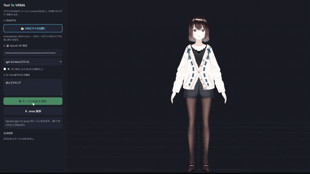

# Text-To-VRMA - 专为 VRM 打造的 Text-To-Motion 工具

[](https://github.com/sponsors/Kirakun0328)



[](README.md) [](README_EN.md) [](README_ZH-CN.md) [](README_KO.md)

> 本译文由 AI 生成，欢迎指正！

这是一款 Web 应用：输入文本后，AI 会生成动作，并直接在浏览器内生成 **VRMA (VRM Animation / `.vrma`)** 文件，当场驱动你的 VRM 角色。生成的 `.vrma` 可以保存为文件，并直接在支持 VRMA 的应用中使用。

示例：“原地走路”“开心地跳起来”“挥手”“难过地低下头”

## ✨ 主要功能
- 📝 **根据文本生成动作**（支持日语）- 提供 LLM 关键帧 / NVIDIA ARDY 两种引擎
- 🧠 **支持 Jev (TypeSafe AI)** - 从输入文本中分析情绪、视线和动作节奏，自动补充表情与动作风格（v1.1.9 起）
- 🚀 **支持最新模型** - OpenAI 支持 GPT-6 系列（`gpt-6-astra` / `gpt-6.1-sol` / `gpt-6-luna`），Claude 支持 Fable 5.1 / Opus 5.5 / Sonnet 5.5 / Haiku 5.5
- 💳 **支持 Codex 订阅** - 除桌面版外，本地 Web 版也能直接使用订阅额度
- 🎬 将生成的动作导出为 **GIF / 视频（1080p）** - 可直接分享到社交媒体
- 🎨 **自定义背景色** - 可设置纯色背景，用于绿幕等色键抠像合成
- ⏱ **按秒指定动作时长**（留空则自动判断，并提供“自动校正”选项）
- ▶ **播放进度条** - 显示当前秒数，可拖动到任意位置并暂停
- 📍 **途经点模式** - 点击 3D 视图中的地面来指定移动路径（ARDY）
- 🎭 **用身体表达情绪** - 不仅体现在表情上，也体现在姿态、手臂、重心和动作的张弛节奏上
- 🔍 **AI 动作复查** - 生成后由 AI 判断是否需要修正，仅在必要时才进行修正
- 🎯 **指令遵循检查** - 在虚拟形象上测量移动、跳跃、下蹲和举手动作
- 🎲 **生成并比较 3 个候选** - 使用不同 seed 生成并对比，择优采用
- ✨ **全身平滑校正** - 柔化突兀的角度变化，同时保护接地部位
- 🔁 **循环播放** - 衔接首尾，实现无缝播放
- 😊 **自动生成表情** + 4 语言界面（日语 / 英语 / 中文 / 韩语）
- 🔌 **支持 OpenAI 兼容服务商** - 也可使用 OpenRouter、DeepSeek、Ollama 等
- 🟣 **支持 Claude API** - 也可使用 Anthropic 的 Claude（claude-opus-5-5 等）生成动作
- 🧭 **连接引导** - 连接失败时（例如 ARDY 引擎未启动），会显示原因以及“启动引擎”等按钮


可从两种生成引擎中选择：

| 引擎 | 特点 | 所需条件 |
| --- | --- | --- |
| **LLM 关键帧**（OpenAI API / Claude API / Codex / 兼容 API） | 擅长精确指定姿势、手指和表情。无需配置，任何电脑都能运行。支持 OpenAI 兼容 API（OpenRouter、DeepSeek、Ollama 等）以及 Anthropic 的 Claude API。 | API Key 或 Codex 套餐 |
| **ARDY 本地引擎**（v1.1 起） | 在本地运行 NVIDIA 的动作生成 AI [ARDY](https://github.com/nv-tlabs/ardy)。行走、舞蹈、跳跃等全身动作可达到**动作捕捉级品质**。生成次数无限制，可离线运行。 | 需要额外配置（见下文） |

在 ARDY 模式下，由 ARDY 生成身体动作。与 Codex 配合使用时，会先设计第一个动作片段的身体动作和表情，然后开始生成和播放，同时并行设计后续片段。已确定片段的时间点和内容会保持不变，新片段追加到末尾。“仅 ARDY”则直接根据输入文本生成。Jev 的分析结果会同时作为辅助信息使用。普通的新生成彼此独立；而在生成过程中重新输入或进行明确的追加修改时，会从当前的物理历史状态无缝衔接。操作方法与限制请参阅 [ARDY 连续生成](docs/ardy-realtime.md)。

| 规划动作的 AI | 所需条件 | 备注 |
| --- | --- | --- |
| **仅 ARDY**（默认） | 无 | 使用 ARDY 内置的翻译进行生成。 |
| **Codex 订阅** | ChatGPT / Codex 套餐 | 在设置面板中显示额度使用率、剩余额度和重置时间。 |
| **OpenAI API** | API Key | GPT-6 Astra / GPT-6.1 Sol（默认）/ GPT-6 Luna |
| **Claude API** | API Key | Fable 5.1 / Opus 5.5（默认）/ Sonnet 5.5 / Haiku 5.5 |

- 使用 Codex 进行连续生成时，如果认证或规划失败，会显示失败原因，不会自动切换到“仅 ARDY”或付费 API。如需直接生成，请选择“仅 ARDY”。
- 生成后的复查与质量设置，请参阅 [动作质量的工作原理](#动作质量的工作原理)。

在生成动作的同时，也会生成**表情**（微笑、悲伤、惊讶、眨眼等）。
眨眼间隔带有自然的随机变化，在惊讶表情期间会减少眨眼。
保存 `.vrma` 时，可以选择“包含 / 不包含表情（仅骨骼动作）”。

界面支持**日语 / 英语 / 中文 / 韩语**，可通过右上角的选择器即时切换。
（首次启动时会根据浏览器的语言设置自动判断。）
*The UI is available in Japanese, English, Chinese and Korean - switch instantly from the selector at the top.*

## 安装与启动

> 🎁 **想免构建直接使用的 Windows 用户：**
> [从 Releases 下载最新版 zip](https://github.com/Kirakun0328/text-to-vrma/releases/latest)
> - 解压后双击 exe 即可（无需安装，并附带完整的 ARDY 引擎配置）。
> 下面的所有配置步骤都可以跳过。

从源码运行有两种方式。如果不确定选哪种，**A. 浏览器版**最快。

| | 启动命令 | 适合人群 |
| --- | --- | --- |
| **A. 浏览器版** | `npm run dev` | 想先试用一下的用户（支持所有操作系统，最少只需 3 条命令） |
| **B. 桌面版（Electron）** | `npm run build` → `npm run app:dev` | 想使用 Codex 订阅认证，或使用应用内 ARDY 引擎配置与自动启动的用户 |

**前置条件：**

| 用途 | 所需条件 |
| --- | --- |
| 通用 | Node.js 20+、git |
| 动作生成（LLM 关键帧） | OpenAI API Key（在 [platform.openai.com](https://platform.openai.com/) 获取）或 Claude API Key（在 [console.anthropic.com](https://console.anthropic.com/) 获取）。本地 Web 版和桌面版也可以改用 Codex 及 ChatGPT/Codex 套餐。 |
| ARDY 本地引擎（可选） | 参见下方 [ARDY 本地引擎章节](#ardy-本地引擎可选)（Python 3.10+ / git，约 20GB 下载量）。**无需 API Key 也能运行。** |

VRM 模型内置了 [VRoid 官方示例模型（AvatarSample）](https://hub.vroid.com/characters/2843975675147313744/models/5644550979324015604) 的 VRM 1.0 版和 VRM 0.0 版，启动时会加载 VRM 1.0 版。你也可以替换为自己的 `.vrm` 文件，**同时支持 0.x 和 1.0 两种格式**（three-vrm 会自动识别并统一朝向）。


### A. 浏览器版

```sh
git clone https://github.com/Kirakun0328/text-to-vrma.git
cd text-to-vrma
npm install
npm run dev
# → 在浏览器中打开 http://localhost:5173
```

### B. 桌面版（Electron）

```sh
git clone https://github.com/Kirakun0328/text-to-vrma.git
cd text-to-vrma
npm install
npm run build
npm run app:dev
```


- Electron 版会加载 Vite 的构建产物（`dist/index.html`）。首次运行以及修改源码后，**请务必先执行 `npm run build`**，再用 `npm run app:dev` 启动
  （如果只是用已构建好的版本重新启动，只执行 `npm run app:dev` 即可）。
- Codex 订阅认证可在桌面版和本地 Web 版（`npm run dev` / `npm run preview`）中使用。

  使用前请务必先完成 Codex CLI 的安装、认证和 PATH 配置
  （应用未内置 Codex CLI）。
  如果未安装或版本过旧，应用内会显示安装和更新的步骤
  （已验证版本为 0.153.3）。
  本地 Web 版通过同源的 Node 服务器连接 `codex app-server`。
  仅托管静态文件时无法使用。模型列表从已登录的账号中获取；如果列表中没有 GPT-6 Astra，说明订阅端暂时还无法选择该模型。
  在源码版中执行 `npm install` 时，也会一并安装已验证的 Codex CLI 0.153.3。
  优先使用项目内的 CLI，仅在不存在时才回退到 PATH 中的 CLI。
  较旧的 CLI 可能不会列出可用的 Astra 模型（已在 0.144.1 和 0.153.3 中确认）。

> [!NOTE]
> 目前的 `npm run app:build`（生成 exe）仅适用于 Windows 便携版，不会生成 macOS 用的 `.app` 或 `.dmg`。

## 使用方法

1. 启动后会加载示例模型（AvatarSample VRM 1.0 版）。

   可以点击“打开 VRM 文件”，或拖放到 3D 视图中，替换为你自己的 VRM。
2. 选择生成引擎
   - **OpenAI API Key**：输入 Key 并选择模型。Key 仅保存在浏览器的
     localStorage 中，除 OpenAI 外不会发送给任何人。
     通过“🔌 使用 OpenAI 兼容服务商”指定 Base URL 和模型名称后，
     也可以使用 OpenRouter、DeepSeek、Ollama 等兼容 API。
     还可以从模型列表中选择 **GPT-6 Astra**（`gpt-6-astra`）。
     它可用于生成、自我修正以及 ARDY 的动作规划；默认模型为 `gpt-6.1-sol`。
     根据 [OpenAI 官方模型信息](https://developers.openai.com/api/docs/models/gpt-6-astra)，
     该模型正在分阶段开放，因此你使用的 API 项目需要具备访问权限。
     在本地 HTTP API 中，可以在请求的 `model` 中指定 `gpt-6-astra`，
     或设置环境变量 `OPENAI_MODEL=gpt-6-astra`。
   - **Claude API**：输入 Anthropic 的 Claude API Key（`sk-ant-...`）并选择模型
     （`claude-fable-5-1` / `claude-opus-5-5` / `claude-sonnet-5-5` / `claude-haiku-5-5`）。
     Key 仅保存在浏览器的 localStorage 中，除 Anthropic 外不会发送给任何人。
     Claude API 支持由 [@AUDOSt0ck1ng](https://github.com/AUDOSt0ck1ng) 贡献
     （[#9](https://github.com/Kirakun0328/text-to-vrma/pull/9)），**贡献者已在浏览器版和桌面版中验证可用，但作者环境中尚未验证**。
     欢迎反馈 Bug 和使用情况。
   - **Codex 订阅（桌面版及本地 Web 版）**：点击“使用 ChatGPT 登录”，
     在默认浏览器中完成认证。如果已经通过 Codex CLI 登录，会直接复用该认证。
   - **ARDY 本地引擎**：在本地运行的动作生成 AI（见下文）
3. 用文本描述动作，然后点击“▶ 生成并播放动作”（也可按 Ctrl+Enter）
   - 可以通过“⏱ 时长（秒）”指定动作时长（留空则自动判断）。
   - 开启“自动校正时长”后，会根据动作数量自动调整为合适的自然时长。
   - 在“循环播放”中可以选择 自动 / 始终循环 / 仅播放一次。
   - “🔍 自我修正”（LLM 模式）会在生成后再执行一轮处理以提升质量。
   - **表演设计 + 图像复查**：可在 Codex（订阅额度）或官方 GPT-6 Astra API 下使用。
     规划表演步骤、支撑腿、重心、视线以及手脚的到达位置，并使用已加载 VRM 的实际尺寸进行生成。
     将正面和侧面的逐帧图像以及实测位置返回给模型，修正一次（共生成 3 次）。
     API 模式按量计费；Codex 模式必须登录 ChatGPT，且不会自动切换到 API Key。
     支持 1 到 15 秒。会替代“常规自我修正”执行。
     完成后可以在对比面板中播放修正前后的动作，并查看表演设计、测量值和发送的图像。
     指标明显恶化的候选不会被自动采用，但会保留以供比较。测量值并不代表物理质量有保证。
     “速度优先”会限制推理量和关键帧数量，“质量优先”则会更充分地思考。
     在修正完成之前，会先播放初稿。对比面板会显示生成初稿所需的时间和总耗时。
4. 生成的动作会在 3D 视图中播放
   - 通过底部的**播放条**可以查看当前秒数、拖动到任意位置并暂停。
   - 使用右上角的**重置相机 / 全屏**以及底部的**切换背景**来调整预览。
5. 在“4. 导出与分享”中导出
   - **⬇ 保存 .vrma** - 可在支持 VRMA 的应用（VRoid Hub、cluster 等）中使用的文件
   - **🎞 导出 GIF / 🎬 导出视频** - 以 1080p 导出并直接分享到社交媒体
   - 也可以在生成历史的每一项中进行播放、保存以及导出 GIF/视频。


## 动作质量的工作原理

生成的动作不会原样输出，而是经过多个阶段来提升质量。
请注意，这些都是**基于几何测量的辅助手段，并不能保证质量**。

### 生成质量

可从“标准”“速度优先”“质量优先”中选择（默认为标准）。
这会改变规划时的推理量和复查次数。速度优先会限制推理量，质量优先则会充分思考，并最多进行 2 次重新评估。

### 结束姿势保持

在连续生成中，每个片段内不应移动的部位会被固定。原本垂下的手臂即使躯干倾斜也会保持沿重力方向下垂；在以“放下手臂”结束的片段中，只会移动仍然抬起的手臂。从空中开始的片段会通过腿部和腰部的上下运动来完成落地。
详情请参阅 [结束姿势保持](docs/end-pose-holding.md)。

### AI 动作复查

生成后，AI 会**首先判断是否需要修正**。如果不需要，则直接采用原始动作，并在预览的“对比修正前后”中显示原因。

- **标准与质量优先** - 直接对原始动作的关节应用修正，并通过另一套判断进行重新评估。

- **速度优先** - 复查发送给 ARDY 的指令并重新生成。

- **同时使用图像** - 应用会自动从正面和侧面拍摄生成的动作，并发送给所选的 AI。

  （用户无需自行准备参考图像。）

自动修正默认关闭。生成后可通过“修正此动作”手动执行。
如果物理指标恶化，或者要求的动作消失，则不会自动采用。
会保留 ARDY 的结束姿势，并避免会导致脚步滑动的强制直立插值。

| | |
| --- | --- |
| 支持的时长 | 1 到 15 秒（Web 版和桌面版的功能） |
| 传递给 AI 的信息 | 脚步滑动、关节角速度、手脚的速度与加速度 |
| 脚步滑动的测量方式 | 根据脚的高度和垂直速度近似判断接地。**这并非物理模拟，也不是全身碰撞检测。** |

### 指令遵循检查

通过以最高 20Hz 测量虚拟形象上的关节位置，检测 4 类动作：移动、双脚跳跃、降低腰部、将手举到脸部附近。

这是一种**几何代理指标**，并不能保证严格的步数、移动方向、动作顺序、表情、自然度、碰撞或物理稳定性。

### 生成并比较 3 个候选

如需比较，可以使用不同的 seed 生成 3 个候选并排对比（通常为 1 个候选）。
当有可比较的检查结果时，会优先考虑检测数量，同时也会检查脚步滑动和下沉。
这不会增加额外的 AI 规划调用，但 ARDY 的生成时间会增加。


### 全身平滑校正

柔化突然的角度变化（默认开启，位于“动作详细设置”中）。
除手臂和上半身外，腿部、脚踝、腰部和手指也在处理范围内。

根据脚踝高度推测接地状态，**在脚处于低位的片段中减弱校正，以保持移动路径**。
这只是基于脚踝高度的推测，并非测量虚拟形象脚底实际接触的 IK 固定。
无法保证在楼梯、台阶或特殊姿势下的接地判断，也无法完全防止脚步滑动。

### 循环播放

如果动作有限定的重复次数或收尾动作，则不会自动循环，而是保持最后的姿势。
明确指定循环时，会将首尾重叠衔接。
对于包含移动的循环，会累积位置和朝向，避免每个周期都回到原点的问题。

> 这种衔接处理**仅用于查看器内的播放**，导出的 `.vrma` 文件中不会包含同样的处理。

## ARDY 本地引擎（可选）

这是一种在本地运行 NVIDIA Research 的 text-to-motion 模型
[ARDY](https://research.nvidia.com/labs/sil/projects/ardy/)（SIGGRAPH 2026），
生成动作捕捉级品质全身动作的模式。

**能做什么：**

- 由基于真人动作捕捉数据训练的 AI 生成行走、奔跑、舞蹈、跳跃、格斗等全身动作（重心转移、惯性和脚部接地都非常逼真）。
- **支持日语提示词** - 通过本地翻译（FuguMT）自动译为英语。
  如果已保存 OpenAI API Key，GPT 会同时负责英译和连续动作的拆分，从而提升准确度。
- **📍 途经点模式** - 点击 3D 视图中的地面放置途经点，即可生成角色按顺序经过这些点的动作（右键单击可撤销一个）。
- 像“走、跑、跳，然后摔倒”这样的**连续动作**，也会由 GPT 拆分并验证，最多可衔接生成 12 个动作（需保存 API Key）。
- 动作时长可以按秒指定（0.1 秒起），也可以根据内容自动判断。表情和是否循环也会自动决定。
- 生成次数无限制，完全本地运行（配置完成后可离线使用）。


**系统要求与性能：**

| | 最低配置 | 推荐配置 |
| --- | --- | --- |
| 操作系统 | Windows 10/11 64 位、macOS、Linux | 同左 |
| 内存 | 16GB | 32GB+ |
| 磁盘 | 35GB | 同左 |
| GPU | 显存 4GB+（没有 GPU 也可用 CPU 运行，每次生成需几十秒） | NVIDIA GPU 6GB+（每次生成数秒） |

> 💡 **ARDY 官方演示需要 20–24GB 显存，而本应用实测将动作模型本体的显存占用降低到了约 1.2GB**（因为占用大部分显存的文本理解部分——8B LLM——被放在 CPU 端运行）。生成过程中显存几乎也不会增加（实测：约 +12MiB）。
> 由于动作模型本体和扩散步数与官方版本完全相同，**生成质量丝毫没有降低**。
> * 数值为通过 `nvidia-smi` 实测所得（进程停止/启动时的显存差值）。
> 模型占用约 1.2GB，且生成时不会增加，即使加上桌面显示的开销，**预计 4GB 显存的 GPU 也足以运行**（已在 12GB 上验证；4–6GB 尚未测试，因此推荐 6GB 以上）。
> 即使没有 GPU，也可以在 CPU 上运行（但生成速度会慢数倍）。

**支撑质量的三层架构** - 分工是“GPT 是大脑，ARDY 是身体”：

| 层 | 作用 |
| --- | --- |
| GPT（可选 / 保存了 API Key 时） | 理解日语意图、拆分连续动作、改写为 ARDY 擅长处理的英语表达 |
| Llama-3-8B（本地 / CPU） | 将英语文本转换为 ARDY 专用的向量（LLM2Vec） |
| ARDY（本地 / GPU） | 由基于真实动作捕捉数据训练的 AI 生成动作 |

即使没有 API Key，也可以通过本地翻译（FuguMT）完成全部流程；但有 Key 时，“先跑，然后跳，最后鞠躬”这类复杂指令的还原度会更高。

**配置**（需要 Python 3.10+ 和 git；下载量约 20GB）：

Windows：

```powershell
powershell -ExecutionPolicy Bypass -File tools\ardy-engine\install.ps1
```

macOS：

```bash
bash tools/ardy-engine/install_mac.sh
```

Linux：

```bash
bash tools/ardy-engine/install_linux.sh
```

Linux 版支持 `apt`、`dnf`、`yum`、`pacman` 和 `zypper`，并会根据需要自动安装 Python 3.10+、git 以及 C++ 构建工具（`gcc`/`g++`、`cmake`）（安装软件包时会使用 `sudo`）。
如果有 NVIDIA GPU，会自动选择 CUDA 版 PyTorch（通过 `nvidia-smi` 判断）。
在浏览器版中使用时，请使用配置完成时显示的 `server.py` 启动命令手动启动引擎。

如果 macOS 上未安装 Homebrew，会在配置过程中自动安装。
macOS 支持由 [@emadurandal](https://github.com/emadurandal)（[#2](https://github.com/Kirakun0328/text-to-vrma/pull/2)）贡献，Linux 支持由 [@mouseos](https://github.com/mouseos)（[#7](https://github.com/Kirakun0328/text-to-vrma/pull/7)）贡献。
**开发者（作者）仅在 Windows 上验证过功能，macOS 和 Linux 尚未在作者环境中验证**
（macOS 和 Linux 已分别由相应的贡献者在实机上验证）。
欢迎提交这些环境下的 Bug 报告、使用反馈以及修复 PR。

完成后，先启动引擎，再在应用中选择“ARDY 本地引擎”模式。
详情、手动启动方法以及 API，请参阅 [tools/ardy-engine/README.md](tools/ardy-engine/README.md)。

本功能使用 Meta Llama 3 作为文本编码器。**Built with Meta Llama 3**

## 基于 Jev (TypeSafe AI) 的语义与情绪分析（可选）

[Jev](https://typesafe.ai/) 是 TypeSafe AI 的“System One 模型”。与生成文本的 LLM 不同，它能将输入句子快速分类为带类型的选项和分数。
在 Text-To-VRMA 中，**Jev 不负责生成动作本身**，它的作用仅限于分析：

- 输入文本的情绪（`emotion`）及其强度（`emotion_intensity`）

- 各情绪的独立分数（`affect`）以及各项的置信度（`confidences`）

- 能量大小（`movement_energy`）、动作幅度、节奏、对人态度以及明确指定的视线

并将这些结果**作为辅助信息**传入生成提示词（ARDY、OpenAI、Claude 和 Codex 通用）。它以原文为优先，不会限定动作类型。旧版分类 `reaction` 仅用于保持分析 API 的兼容性，不会传给身体动作生成。独立的情绪分数也会用于预先表情；如果 ARDY 的面部尚未设计，会以简短的开场表情补充到 VRMA 中。
已有的表情轨道和中途的情绪变化会被保留。

**如果有 Jev API Key，会自动使用。** 未配置、出错或超时时，会在不使用 Jev 的情况下继续生成。即使整体置信度较低，也不会丢弃全部分析结果，而是根据各项的置信度分别处理。
在与 Codex 配合的连续生成中，片段设计与 Jev 分析会并行执行，待第一个身体与表情片段确定后再启动 ARDY。
后续的规划会追加到末尾，晚到的 Jev 分析结果会传给尚未播放片段的生成条件，不会覆盖已经播放的动作或由 Codex 设计的表情。

### 启用方法

- **应用 / 浏览器版**：在“设置”中（位于语言选择器左侧，与其他 API Key 在同一栏）输入 Jev API Key，并选择模型（`jev-latest` / `jev-preview` / `jev-1.13.0`）。更改会自动保存。
- **本地 HTTP API（`npm run api`）**：在 `.env` 文件中设置 `JEV_API_KEY`。
  设置 `JEV_ENABLED=false` 可以明确禁用整个服务器的 Jev 功能（参见 `.env.example`）。

### 日语会先译为英语再进行分析

Jev 主要面向英语，TypeSafe AI 的文档中也指出其他语言的准确度会下降。因此，日语输入会先通过 ARDY 引擎内置的翻译模型（FuguMT）译为英语，再发送给 Jev。如果 ARDY 引擎未启动，或翻译未能在 2 秒内完成，则会像以前一样直接发送原文。可以在设置中的“翻译为英语后再发送给 Jev”关闭此功能
（本地 HTTP API 可使用环境变量 `JEV_TRANSLATE=0`）。规划动作的 AI（如 Astra 或 Claude）则会直接接收日语原文。

### API Key 的处理方式

与 OpenAI 和 Claude 的 Key 采用相同的策略。在应用中，Key 保存在 `localStorage` 中，并通过 Electron IPC 或同源的本地连接服务器发送给 Jev（`https://api.typesafe.ai`）。源码中没有硬编码，也不会输出到日志中（分析结果日志只保留情绪、反应和置信度，不包含 API Key 和完整的输入文本）。


### 通过本地 HTTP API 使用

`POST /v1/motions` 中的 `use_jev` 是可选的布尔值。省略时，如果服务器上配置了 Key 就会自动使用；如果为 `false`，则仅针对该请求跳过分析。

```bash
curl -X POST http://127.0.0.1:8787/v1/motions \
  -H "Content-Type: application/json" \
  -d '{"prompt":"Yay! It is finally finished!!","engine":"ardy","use_jev":true}'
```

如果只需要分析结果（不生成动作），可以使用专用端点。

```bash
curl -X POST http://127.0.0.1:8787/v1/motion-context \
  -H "Content-Type: application/json" \
  -d '{"text":"Eh!? Really!?"}'
# => {"emotion":"surprise","emotion_intensity":0.8,"reaction":"startled", ...}
```


只有当服务器端配置了 `JEV_API_KEY` 且未被明确禁用时，`use_jev` 才会实际生效；请求方无法传入 API Key，也无法覆盖管理员的配置。现有的 Host/Origin/Token 校验同样适用于这两个端点。

### 关于网络通信

启用 Jev 后，输入文本（最多截取 2000 个字符）会发送到 TypeSafe AI 的 API（`https://api.typesafe.ai`）。新的生成不会发送之前的表演状态。
明确的追加修改则还会传递当前动作、姿势、表情和播放位置等有限的状态信息。

使用路径、延迟到达以及是否已应用到身体等信息，会记录在生成 spec 的 `jevContext`、`jev` 和 `realtime.jev` 中。
关于路径与限制，请参阅 [将 Jev 接入生成流程](docs/jev-generation-integration.md)。

## 架构


```text
[LLM Keyframe Mode]
Text ── OpenAI API / Codex CLI ──▶ Motion Spec (Bone-specific Euler angle keyframe JSON)

[ARDY Mode]
Text ── Selected AI (Acting Planning & Action Splitting) ──▶ ARDY Engine Server (localhost:2337)
            │  Codex / OpenAI / Claude         │ Generates 20fps motion via diffusion model
            └ No AI -> ARDY Built-in Translation │ → Foot Slide Correction → VRM Retargeting
                                               ▼
                                     Motion Spec ──▶ Smoothness Correction ──▶ AI Review (Optional)
```

从 spec 开始，两种模式的流程相同：

```text
                         Motion Spec
                              │
                              ▼
              vrmaBuilder.js ── glTF + VRMC_vrm_animation Extension → GLB (.vrma)
                              │
                              ▼
              viewer.js ── Plays back on VRM using three.js + @pixiv/three-vrm-animation
```


| 文件 | 作用 / 说明 |
| --- | --- |
| `src/llm.js` | 发送给 OpenAI API 的提示词（骨骼约定 / 5 个示例动作）/ 两轮自我修正 / spec 校验与角度限制 |
| `src/vrmaBuilder.js` | 根据动作 spec 生成 VRMA (GLB) 二进制文件。嵌入符合 VRM 1 约定的 T-pose 骨架，并通过 `VRMC_vrm_animation` 扩展映射人形骨骼 |
| `src/viewer.js` | three.js 场景 / VRM 加载 / VRMA 播放 |
| `src/idleMotion.js` | 待机动作（呼吸） |
| `src/main.js` | UI 绑定 |
| `src/autoExpressions.js` | 用于 ARDY 模式：根据情绪词自动添加表情 + 眨眼（支持混合情绪和按时间顺序变化的情绪） |
| `src/emotionActing.js` | 将情绪反映到身体动作中的通用准则（在规划、生成和复查中共用） |
| `src/smoothMotion.js` | 全身平滑校正。根据脚踝高度推测接地，并在接地附近减弱校正 |
| `src/motionCompliance.js` | 指令遵循检查。在虚拟形象上测量移动、跳跃、下蹲和举手 |
| `src/ardyCandidates.js` / `src/candidatePanel.js` | 3 个候选的生成、比较与选择 |
| `src/motionReview.js` / `src/ardyReview.js` | 生成后的 AI 复查（包括判断是否需要修正） |
| `src/directMotionReview.js` / `src/motionPatch.js` | 直接修正关节的处理路径，及其应用与校验 |
| `src/segmentedReview.js` | 将较长的动作拆分为约 15 秒的片段进行修正 |
| `src/motionAssessment.js` | 计算脚步滑动、下沉等物理指标 |
| `src/reviewCapture.js` | 自动拍摄生成动作的正面和侧面（用于图像复查） |
| `src/motionCheckPanel.js` / `src/reviewI18n.js` | 播放状态、生成路径和检查结果的显示及多语言化 |
| `src/loopPlayback.js` | 处理循环播放时首尾的衔接 |
| `src/codexWebBridge.js` / `src/codexUsage.js` | 本地 Web 版的 Codex 连接与额度显示 |
| `tools/codex-web.mjs` | 将请求从 Vite 开发服务器转发到 `codex app-server` 的插件 |
| `electron/codex-client.cjs` | Codex app-server 连接 / ChatGPT 认证 / 模型获取 / 在临时线程中生成 |
| `electron/ardy-client.cjs` | 启动并监控 ARDY 引擎服务器（桌面版） |
| `electron/preload.cjs` | 不暴露认证凭据的受限 IPC 桥 |
| `src/apiServer.js` | 本地 HTTP API 核心（同时支持 OpenAI 和 ARDY 引擎） |
| `tools/api-server.mjs` | API 服务器启动入口（`npm run api`） |
| `tools/ardy-engine/server.py` | ARDY 常驻服务器：生成、日语翻译、途经点约束、进度 API |
| `tools/ardy-engine/retarget.py` | ARDY Core 骨架 → VRM Humanoid 重定向 |
| `tools/ardy-engine/install.ps1` | 一条命令完成引擎配置（Windows） |
| `tools/ardy-engine/install_mac.sh` | 一条命令完成 macOS 引擎配置 |
| `tools/ardy-engine/install_linux.sh` | 一条命令完成 Linux 引擎配置 |


## 动作 spec 格式
这是由 LLM 生成的中间表示：

```json
{
  "name": "wave",
  "duration": 2.6,
  "loop": true,
  "tracks": {
    "rightUpperArm": [
      { "t": 0, "r": [0, 0, 70] },
      { "t": 0.4, "r": [0, 0, -45] }
    ]
  },
  "hips": [ { "t": 0, "p": [0, 0, 0] } ]
}
```

- `r` = 相对于 T-pose 的欧拉角 [X, Y, Z]（度）/ `p` = 腰部（Hips）位置偏移（米）
- `expressions` = VRM 预设表情（happy、blink 等）的权重（0 到 1）。
  在预览中始终会播放，保存 `.vrma` 时可以选择是否包含
  （需要播放端应用支持 VRMA 的表情轨道）。
- 坐标约定：模型朝向 +Z / +X 为左手侧（遵循 VRM 1.0）。

## 本地 HTTP API（面向开发者的实验性功能）

> **这是 v1.1.7 新增的实验性功能。** 尤其是通过 ARDY 引擎进行的生成，
> 验证还不充分，接口将来也可能发生变化。
> **非常欢迎实际使用后的反馈和 Bug 报告** -
> 请随时提交到 [Issues](https://github.com/Kirakun0328/text-to-vrma/issues)。

这是一个本地 API 服务器，用于从其他应用或脚本调用 Text-To-VRMA。
你可以从 Unity、Blender、自制工具或 Shell 脚本发送文本，并接收动作 spec 或 `.vrma` 文件。


```bash
cp .env.example .env   # 仅首次需要。设置 OPENAI_API_KEY（仅使用 ARDY 时不需要）
npm run api            # 在 http://127.0.0.1:8787 启动服务器
```

将 `.env` 放在仓库根目录下，启动时会自动读取（该文件不会被 Git 跟踪）。
启动后会显示当前可用的引擎：

```text
Loaded .env
Text-To-VRMA API listening on http://127.0.0.1:8787
  engine=openai : Not configured (Please set OPENAI_API_KEY in .env)
  engine=claude : Not configured (Please set ANTHROPIC_API_KEY in .env)
  engine=ardy   : Available (ARDY-Core-RP-20FPS-Horizon40 / GPU)
```

`engine=ardy` **无需 API Key 即可使用**（需要启动 ARDY 本地引擎）。
`engine=openai` / `engine=claude` 需要 Key，但无需配置 ARDY。

### 在桌面版中使用（v1.1.7 起）

无需使用命令行，可以在应用的“高级设置 → 本地 HTTP API”中启用。
**默认关闭**，只有勾选后才会在 127.0.0.1 上开放端口。

- 会直接使用应用中已配置的 OpenAI / Claude Key，无需重复配置。
- **必须使用访问令牌**。令牌会显示在设置栏中，请在调用端以 `Authorization: Bearer <token>` 的形式指定。由于每次安装的令牌固定不变，外部工具只需配置一次。如果令牌泄露，可以通过“🔄 重新生成”使其失效。
- 如果端口已被占用，会显示提示（请指定其他端口）。

```bash
curl -X POST http://127.0.0.1:8787/v1/motions \
  -H "Authorization: Bearer <token displayed in app>" \
  -H "Content-Type: application/json" \
  -d '{"prompt":"walk forward and wave hand","engine":"ardy","format":"vrma"}' \
  -o walk.vrma
```

### 安全性

**默认仅监听 127.0.0.1**，因此只有同一台电脑上的应用才能访问。
对外公开时必须设置 `TEXT_TO_MOTION_API_TOKEN`；未设置则启动时会报错（此时所有请求都需要携带 `Authorization: Bearer <token>`）。

| 端点 | 说明 |
| --- | --- |
| `GET /health` | 运行状态、可用引擎以及 Key 的配置情况 |
| `GET /openapi.json` | OpenAPI 3.1 定义 |
| `POST /v1/motions` | 根据文本生成动作 |
| `POST /v1/vrma` | 将现有 spec 转换为 `.vrma`（无需 Key） |
| `POST /v1/motion-context` | 仅通过 Jev 分析语义与情绪（仅在配置了 Jev 时可用；见下文） |

`POST /v1/motions` 的请求参数：

| 字段 | 默认值 | 说明 |
| --- | --- | --- |
| `prompt` | （必填） | 动作指令，1 到 4,000 个字符 |
| `engine` | `openai` | `openai` / `claude` / `codex` = LLM 关键帧 / `ardy` = ARDY 本地引擎 |
| `planner` | `codex` | 仅 `ardy`：用于动作规划的 AI（`codex` / `openai` / `claude` / `none`） |
| `speed` | - | `openai` / `codex`：`fast` / `balanced` / `quality`。`fast` 会减少推理量和关键帧数量 |
| `format` | `json` | `json` 返回 spec，`vrma` 返回 `.vrma` 二进制文件 |
| `model` | 环境变量 | `openai`/`claude` 中为生成模型，`ardy` 中为用于拆分动作的 GPT 模型 |
| `refine` | `true` | 在 `openai` 和 `claude` 中启用两轮自我修正 |
| `duration` | - | 仅 `ardy`：生成时长（秒） |
| `waypoints` | - | 仅 `ardy`：移动路径 `[{ "x": 1, "z": 2 }]` |
| `use_jev` | 配置 Key 时自动启用 | 使用 Jev 分析语义与情绪，并作为辅助信息使用。`false` 可按请求禁用。如果服务器未配置 Jev，则照常生成 |

```bash
# 使用 ARDY 本地引擎生成（无需 API Key；需要启动引擎）
curl -X POST http://127.0.0.1:8787/v1/motions \
  -H "Content-Type: application/json" \
  -d '{"prompt":"walk forward and wave hand","engine":"ardy","format":"vrma"}' \
  -o walk.vrma

# 使用 OpenAI API Key 生成（服务器启动时需要 OPENAI_API_KEY）
curl -X POST http://127.0.0.1:8787/v1/motions \
  -H "Content-Type: application/json" \
  -d '{"prompt":"bow"}'
```

```bash
# 使用 Claude 生成（服务器启动时需要 ANTHROPIC_API_KEY）
curl -X POST http://127.0.0.1:8787/v1/motions \
  -H "Content-Type: application/json" \
  -d '{"prompt":"bow","engine":"claude","model":"claude-sonnet-5-5"}'
```

环境变量：`PORT`（默认 8787）/ `HOST`（默认 127.0.0.1）/ `OPENAI_API_KEY` /
`OPENAI_BASE_URL` / `OPENAI_MODEL` / `ANTHROPIC_API_KEY` / `ANTHROPIC_MODEL` /
`ARDY_URL`（默认 `http://127.0.0.1:2337`）/
`TEXT_TO_MOTION_API_TOKEN` / `TEXT_TO_MOTION_CORS_ORIGIN` /
`JEV_API_KEY` / `JEV_ENABLED` / `JEV_MODEL` / `JEV_TIMEOUT_MS` /
`JEV_CONFIDENCE_THRESHOLD`（详情请参阅上文的“基于 Jev (TypeSafe AI) 的语义与情绪分析”）。

为防止恶意网页擅自调用，实施了以下多层防护：

| 防护措施 | 内容 |
| --- | --- |
| 绑定地址 | 仅限 127.0.0.1。对外公开时必须设置 `TEXT_TO_MOTION_API_TOKEN` |
| Host 校验 | 非回环地址名称返回 403（防范 DNS 重绑定攻击） |
| Origin 校验 | 如果存在则进行校验，外部来源返回 403 |
| Sec-Fetch-Site | `cross-site` 返回 403 |
| Content-Type | POST 仅接受 `application/json`（否则返回 415） |
| 请求方法 | GET / POST / OPTIONS 以外的方法返回 405 |
| CORS | 默认不返回相关响应头（不使用通配符） |
| 大小限制 | 请求体 1 MiB |
| 令牌 | 桌面版中为必需。CLI 中也可通过 `TEXT_TO_MOTION_API_TOKEN` 启用 |

已通过测试确保 API Key 的值绝不会包含在响应中。
但请注意，**任何能访问到该 API 的人，即使看不到 Key 也能“使用”它**
（会执行生成并消耗使用额度）。这就是桌面版强制要求令牌的原因。

> **仅在从浏览器中的网页调用时**才需要配置 `TEXT_TO_MOTION_CORS_ORIGIN`
> （由于默认不返回 CORS 响应头，浏览器端会拦截请求）。
> curl、Python、Unity、Node 等浏览器以外的客户端不受此限制。

## 注意事项

- **已验证环境：Windows 11**（虽然为 macOS / Linux 提供了配置脚本，但作者仅在 Windows 上进行了开发验证。由于是在浏览器中运行的 Web 应用，预计可以正常工作，但不作保证。欢迎提交 Bug 报告和修复 PR）
- API Key 模式下的动作生成会产生 OpenAI API 使用费用（每次约几日元到十几日元不等，具体取决于所用模型和动作时长）。
- 启用 OpenAI 的 [每日免费令牌数据共享计划（Complimentary daily tokens）](https://help.openai.com/en/articles/10306912-sharing-feedback-evaluation-and-fine-tuning-data-and-api-inputs-and-outputs-with-openai) 后，可以在每日免费令牌额度内**免费试用**
  （请注意，API 的输入和输出会被共享给 OpenAI 用于模型训练。需满足账号和地区的适用条件。该计划可能会由 OpenAI 自行决定变更或终止）。
- Codex 模式遵循所登录 ChatGPT/Codex 套餐的使用上限和组织策略。
  在本工具中使用 Codex 订阅是否符合 OpenAI 的服务条款和政策，请用户自行确认（使用风险自负）。
- 在应用内退出 Codex 登录，会影响这台电脑上整个 Codex CLI 的登录状态。
- **即使使用 ARDY 本地引擎，只要设置了 OpenAI API Key（或兼容 API），就能由 AI 负责复杂动作的理解、拆分和验证，更容易得到符合预期的动作**
  （没有 API Key 时也可以通过本地翻译运行）。
- ARDY 本地引擎是实验性功能。受模型特性影响，即使文本相同，每次生成的动作也会不同（如果不满意，请重新生成）。
  模型权重（NVIDIA ARDY / Meta Llama 3 / FuguMT）不包含在本仓库中，需要用户在配置时自行从各自的发布方（Hugging Face）下载。
  各模型的许可证请参阅 [THIRD_PARTY_NOTICES.md](THIRD_PARTY_NOTICES.md)。
- 生成的 `.vrma` 文件请自行承担使用风险。

## 免责声明

本软件按“原样”提供，不附带任何形式的保证。
对于因使用或无法使用本软件而产生的任何损失
（包括 API 费用、数据丢失、由生成内容引起的纠纷等），开发者概不负责。
生成的 `.vrma` 文件以及各类 AI/API 的使用，均由用户自行承担风险。

## 💖 支持本项目

**Text-To-VRMA 是由个人开发者打造的免费开源项目。**

“只需输入文本，任何人都能让自己的角色动起来”——
怀着这一愿景，包括集成 NVIDIA 最新动作 AI（ARDY）这样的挑战在内，我计划今后继续发布方便易用的开源工具。

坦白说，我目前处于待业状态，在经济拮据的情况下坚持开发。
但我仍有很多想做的东西。如果这个工具对你有所帮助，你的支持和鼓励将对我意义重大。🙇

---

**Text-To-VRMA is free & open-source, built by an independent developer in Japan.**

The goal: anyone can bring their VRM character to life just by typing -
powered by state-of-the-art motion AI, running on your own PC, free forever.

I'll be honest: I'm currently between jobs and building this through financially
difficult times. But there is so much more I want to create - more open-source
tools for the VRM / VTuber / creative community.

If this tool helps any of you, in any way, or if you simply want to see more projects like it,
your support genuinely keeps this work (and its developer) going 💚

### **[❤️ GitHub Sponsors - github.com/sponsors/Kirakun0328](https://github.com/sponsors/Kirakun0328)**

哪怕只是给本仓库点一个 ⭐，对我来说也意义重大！谢谢！

## 🙏 贡献者

- [@emadurandal](https://github.com/emadurandal) - macOS 支持（ARDY 引擎的 macOS 安装程序及启动稳定性改进，[#2](https://github.com/Kirakun0328/text-to-vrma/pull/2)），以及时长指定相关的 Bug 报告（[#5](https://github.com/Kirakun0328/text-to-vrma/issues/5)）。
  感谢你的出色贡献！
- [@taiyop](https://github.com/taiyop) - 在 README 中补充了 Electron 桌面版的构建与启动步骤（[#3](https://github.com/Kirakun0328/text-to-vrma/pull/3)）。
  谢谢！
- [@zzmzaizai](https://github.com/zzmzaizai) - 提议支持 OpenAI 兼容服务商（[#4](https://github.com/Kirakun0328/text-to-vrma/issues/4)）。
  谢谢！
- [@mouseos](https://github.com/mouseos) - Linux 支持（ARDY 引擎的 Linux 安装程序及启动分支，已在实机上验证，[#7](https://github.com/Kirakun0328/text-to-vrma/pull/7)）。
  感谢你的出色贡献！
- [@Misuta890](https://github.com/Misuta890) - 修复了 Electron 版中切换引擎的 Bug（[#8](https://github.com/Kirakun0328/text-to-vrma/pull/8)）。
  谢谢！
- [@AUDOSt0ck1ng](https://github.com/AUDOSt0ck1ng) - Claude API (Anthropic) 支持（已在浏览器版和桌面版中验证，[#9](https://github.com/Kirakun0328/text-to-vrma/pull/9) / [#11](https://github.com/Kirakun0328/text-to-vrma/issues/11)）。
  感谢你的出色贡献！
- [@hsm-hx](https://github.com/hsm-hx) - 支持 Claude 5.5 系列和 Fable 5.1，以及拒绝响应时的服务器端回退（[#17](https://github.com/Kirakun0328/text-to-vrma/pull/17)）。
  谢谢！
- [@meryuhi](https://github.com/meryuhi) - 修复了 ARDY 引擎重定向时脚部悬空的问题（在 Unity 中测量并确认了脚踝高度，[#18](https://github.com/Kirakun0328/text-to-vrma/pull/18)）。
  谢谢！
- [@loneicewolf](https://github.com/loneicewolf) - 将 README 翻译为英语并进行校对（README_EN）。谢谢！

随时欢迎 Bug 报告、功能建议和 PR。macOS / Linux 环境的改进在很大程度上依赖社区的力量。

## 开发者

- X (Twitter)：[@Kiratchi0328](https://x.com/Kiratchi0328)

## 许可证

- 源代码：MIT License（Copyright (c) 2026 Kiratchi）。
  **MIT License 仅适用于源代码，不包括第三方素材（内置的 VRM 模型等）**
  （详情请参阅 [THIRD_PARTY_NOTICES.md](THIRD_PARTY_NOTICES.md)）。
- **关于署名的请求**：将本工具集成到应用或服务中时，
  虽然不是强制要求，但如果能在界面或致谢栏中加入如下署名，我将不胜感激：

  ```text
  Motion generation powered by Text-To-VRMA (© Kiratchi)
  https://github.com/Kirakun0328/text-to-vrma
  ```

  另外，根据 MIT 许可证的条件，复制和再分发代码时需要附上上述版权声明和许可证文本。

- ARDY 本地引擎所使用的外部模型的许可证：
  - NVIDIA ARDY - 代码：Apache-2.0 / 权重：NVIDIA Open Model Agreement（允许商用）
  - Meta Llama 3 - Meta Llama 3 Community License。本功能 **Built with Meta Llama 3**
  - FuguMT（日英翻译）- CC BY-SA 4.0
  - 详情请参阅 [THIRD_PARTY_NOTICES.md](THIRD_PARTY_NOTICES.md)。
- 内置的 AvatarSample 模型（© pixiv Inc.）**不适用 MIT License**。
  适用 pixiv Inc. 的 [AvatarSample A-Z 使用条款](https://vroid.pixiv.help/hc/ja/articles/4402394424089-AvatarSample-A-Z)
  （允许免费使用和再分发 / **禁止付费再分发以及以 CC0 形式分发**）。
  模型的版权及其他权利归各自的权利人所有。
- 其他 VRM 模型请遵守各模型的使用条款。
- **生成的 `.vrma` 文件不适用 MIT License**，归生成它的用户所有。
  本项目不对生成内容主张任何权利，用户可以自由使用，包括商业用途。
