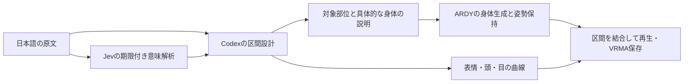

# Jevの調査とモーション設計への反映

調査日：2026-09-21。目的は、表情や視線の指示から不要な全身動作が発生する問題を、Jevの役割と生成経路の両方から見直すこと。
この記事は外部調査、実装した内容、未検証の範囲を区別して記録する。

## 読んだ記事と一次資料

指定された[npaka「Jevのクイックスタート」](https://note.com/npaka/n/n5ac6abd04d67)と、関連する[npakaのJev概要記事](https://note.com/npaka/n/n6f8dd30a5fa4)を入口に、APIの型や設計パターンはTypeSafe公式資料で確認した。
公開記事のモデル間比較を、そのまま本アプリの速度・品質保証には使わない。

| 資料 | 確認した内容 |
| --- | --- |
| [公式Primitives](https://docs.typesafe.ai/primitives) | 一つの質問に一つの判断を置く。同じ呼び出しの質問は独立し、質問ID自体はモデルの文脈にならない |
| [公式Choice](https://docs.typesafe.ai/primitives/choice) | 選択肢の確率分布と、その分布の集中度に由来する信頼度を返す |
| [公式Score](https://docs.typesafe.ai/primitives/score) | 程度を段階に沿って評価する。異なる意味の軸は別々に質問する |
| [公式Noul](https://docs.typesafe.ai/primitives/noul) | Yesの確率を返す。0.5は不確実であり、対象の程度が中くらいという意味ではない |
| [公式Speculative fan-out](https://docs.typesafe.ai/patterns/fan-out) | 同じstateで答えられる質問を一回にまとめ、必要な結果を後段で使う |
| [公式発表](https://typesafe.ai/blog/introducing-system-one-models-and-jev) | Jevは自由な文章生成を担当しない。公開DOOMデモも構造化した状態を使い、画像からの動作生成を示したものではない |

当アプリへの適用判断は、Jevに「どの仕草か」を選ばせるより、部位・表情・視線・時間変化を独立して評価させ、自由な演技の構成はCodexに残す、というもの。
これは上記仕様からの設計上の判断であり、Jev自体が関節軌跡を生成できるという主張ではない。

## 実運用の記事から注意した点

[YTALの名寄せ検証](https://ytal.io/blog/typesafe-jev-entity-resolution-production-replay/)は、保存済みの本番入力を再送したリプレイで、本番導入の報告ではない。
人が付けた正解ラベルもなく、既存処理との一致を正解率とは扱っていない。
低い信頼度を項目単位から大きな処理単位へまとめる設計によって保留が増え、既存処理への戻し方によっては総コストが増える試算も示している。

ここから本アプリに採用したのは、全項目の最低信頼度で生成を止めないこと、一項目の不正回答で他の情報を捨てないこと、解析を後段へ重複適用しないこと。
同記事の名寄せ性能や費用は、モーション生成での改善率には換算しない。

## 実装した役割分担

Jevキーがなければ原文から直ちにCodex計画へ進む。解析失敗や期限切れも同じ経路で続行する。
Jev設定済みのCodex経路では、解析を最初の設計前に渡す。最初の確定区間から再生を始め、設計が完成した区間を順に追加する。
旧方式の「Codex開始後に届いたJev結果をARDYの文章へ追加」は、Codexが設計を担当するセッションでは無効にした。
明示的なARDY単独選択はCodexを呼ばず、従来の意味・スタイル補助を維持する。

解析は33問を一回で送る。Choice 7問、Score 12問、Noul 14問で、通信を質問数だけ繰り返す構成にはしない。
追加された質問・回答は入力トークンやCodexへ渡す文脈を増やすため、一括化だけでアプリ全体が速くなるとは言えない。
数を減らす場合も、単なる質問数ではなく、実測の遅延と各項目を除いた場合の指示追従を比較する必要がある。

| 解析結果 | 設計時の使い方 |
| --- | --- |
| 部位別Noul `body_intent` | 原文が要求する身体の範囲を確認する根拠。確率を機械的なしきい値で関節固定へ変換しない |
| 表情・視線のNoul `channel_intent` | 身体を動かす依頼と、目・顔を変える依頼を区別する根拠 |
| 時間変化のNoul `temporal` | 開始感情を全体に固定せず、順序と変化を原文から設計する根拠 |
| 開始／終了の独立Score | 混合感情と感情推移を区別する。中間の時刻や曲線はCodexが原文から設計する |
| Choice／Scoreの確率と信頼度 | 曖昧さを保持した補助情報。生成中止条件や確定的な動作命令にはしない |

Codexの`body`は七つの関節群の担当指定で、動作辞書ではない。全身動作には必要なすべての部位を使用できる。
頭・視線・顔は別曲線として設計し、身体用キャプションから台詞や感情名などを除く。
ARDYは非対象関節を保持し、身体変更のない区間は身体推論を省略する。
これにより、表情だけの指示で毎回腕まで新規推論させる経路を除いた。未知の動作を既製の挨拶や照れ仕草に置換する処理は入れていない。

## 確認できたことと未検証のこと

解析・補助JSONのテストでは、部位の左右、Noulの0／0.5、開始と終了の分離、不正回答の部分除外、
任意フィールドの除去、固定仕草カテゴリの不送信を確認した。関連するAPI・計画・レビュー経路の自動テストも通過した。
これらは処理の接続と型の検証で、実Jevの日本語理解や、生成した動作の自然さの評価ではない。

今回、実Jev APIを使った変更前後の精度・通信時間の比較は行っていない。
実Astra→ARDYの3入力を`http://127.0.0.1:5173`経由で生成し、VRM上の映像と関節軌跡を確認した。
提示された視線・微笑みの入力では、Codexが身体変更なしと独立した視線・表情を設計し、不要な腕の交差は発生しなかった。
同時に、片腕だけを動かす区間では密な関節制約による動きの減衰が見つかった。
同じキャプション・同じ評価専用seedの比較で、推論中の全固定関節制約を外し、生成後の部位保持だけにすると腕の上昇が戻った。
採用した方式は、推論中には保持する骨盤位置・向きだけを条件にし、関節角は生成後に保持する。
比較では左手の最高位置が腰から+0.011mから+0.575mになった。初回とウォーム状態が異なるため、この比較の処理時間から速度向上は主張しない。
本番推論に固定seedは使用しない。検証した一入力の成功を、任意動作の精度保証とは扱わない。

初回の3入力評価では最初のVRMA構築まで7.81〜13.76秒で、視線のみの入力もCodex設計待ちが支配的だった。
これは実Jev通信・ブラウザ描画を含まないNode評価であり、即時生成を達成した数値ではない。
歩行時の過剰な腕上げも残った。全部位を必要とする動作に対しては、部位固定だけでARDYの内容の誤りを解消できない。
記録：`release/jev-intent-scope-eval/results.json`、`visual-inspection.json`、`release/ardy-scope-conditioning-eval/results.json`。
採用方式の比較記録：`release/ardy-scope-root-condition-eval/results.json`。

最終構成では同じ視線・微笑みの指示をブラウザUIから実生成し、最初の描画12.61秒、完了15.20秒だった（6秒指定、Astra low、Jev未設定）。
実際の視線角の変化、1件の履歴追加、100%完了、非ループ再生の終了を確認した。
記録：`release/intent-gaze-fix/browser-check.json`。これはJevの改善率測定ではなく、アプリの実行・保存の確認である。
JavaScript 248件、Python 55件と本番ビルドが成功した。既存のバンドルサイズ警告は残る。

修正後の新規乱数による複合動作も実Astra→ARDYで再生成した。左手の上昇、右への旋回、深いしゃがみを映像で確認した。
最初のVRMAまで11.24秒、途中の待ちが合計1.70秒あった。左手を完全に下ろしきる終端は不足し、その姿勢を後続へ保持する課題が残る。
記録：`release/jev-intent-final-eval/results.json`・`visual-inspection.json`。

項目ごとの解析、Codexの計画、実際の関節・視線・表情、最初の表示時間と途中の待ち時間を分けて評価する。
Jevを追加したことだけを理由に精度や応答速度の向上を断定しない。

頭部の数値カーブからARDYの頭部生成に切り替える際は約150msで表示・保存トラックを補間する。
この頭部補間をARDY内部のネイティブ姿勢へ戻す処理は未実装で、現在は表示の連続性を保つ範囲にとどまる。

実装のフィールドと履歴上の注意は [生成経路への接続](jev-generation-integration.md)、過去の測定は [品質と遅延](realtime-quality-latency.md) を参照。
